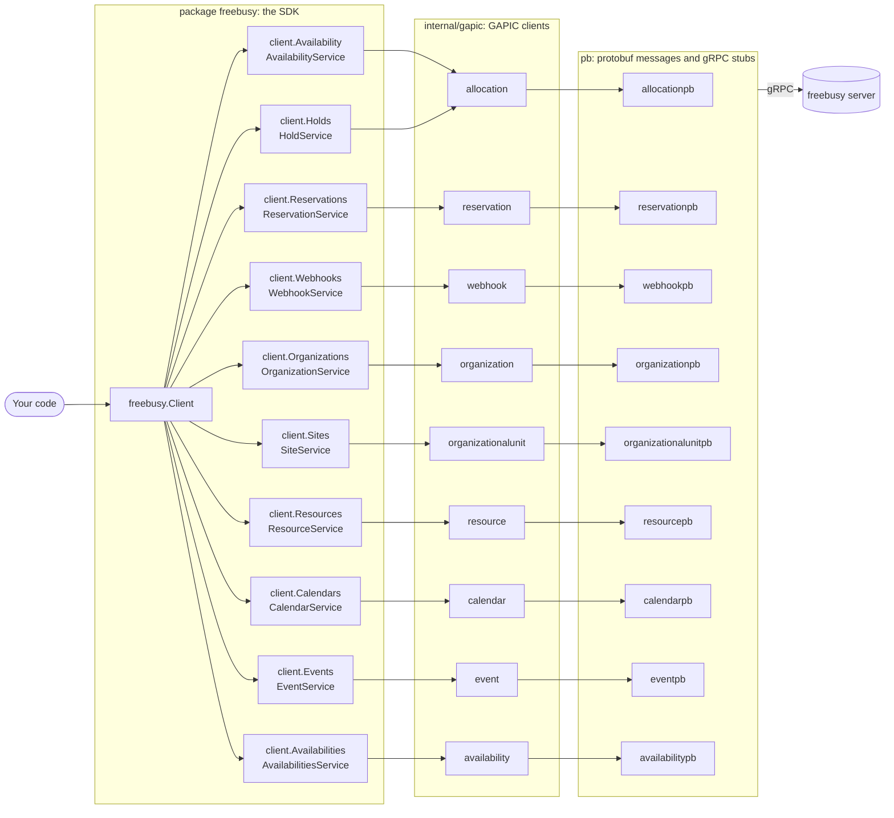

<!-- Code generated by protoc-gen-sdk dev. DO NOT EDIT. -->
# freebusy Go SDK

[](https://pkg.go.dev/github.com/oh-tarnished/freebusy-go-sdk)
[](https://github.com/oh-tarnished/freebusy-go-sdk/actions/workflows/ci.yaml)

Availability, holds, reservations and webhooks for anything that can be booked.

freebusy answers what is free, holds it while a customer decides, and
turns holds into reservations, for any bookable resource: rooms, bays,
desks, people.

The freebusy Go SDK is one client for every service of the freebusy API,
over gRPC. Requests and responses are the API's own protobuf messages, as
types of package `freebusy`; errors are typed; list methods page
automatically; every option can be set for the client, one service, or one
call.

## Contents

- [How it fits together](#how-it-fits-together)
- [Installation](#installation)
- [Quick start](#quick-start)
- [Configuration](#configuration)
- [Services](#services)
- [Errors](#errors)
- [Pagination](#pagination)
- [Concurrency control (etags)](#concurrency-control-etags)
- [Retries and timeouts](#retries-and-timeouts)
- [Webhooks](#webhooks)
- [Examples](#examples)
- [Versioning](#versioning)

## How it fits together

You use package `freebusy` (the client and its services, declared in
`service/` and aliased at the root) and the `pb/<package>pb`
packages (the API's request and response messages). Underneath, Google's
GAPIC clients (`internal/gapic`, not importable) call the gRPC stubs:



| Directory | What | Generated by |
|---|---|---|
| `/` | package `freebusy`: every name of `service/`, as an alias (`freebusy.Client` is `service.Client`), and the package docs | protoc-gen-sdk |
| `service/` | `Client`, one service type per API service (a file each), `Error`, `AutoPager` | protoc-gen-sdk |
| `option/` | client, service and call options | protoc-gen-sdk |
| `pb/<name>pb/` | the API's messages and enums (`*.pb.go`), gRPC client stubs (`*_grpc.pb.go`) | protoc-gen-go, protoc-gen-sdk |
| `internal/gapic/<name>/` | GAPIC clients, as GAPIC writes them | protoc-gen-go_gapic |
| `internal/request/` | what options build up | protoc-gen-sdk |

The API's resources, and the client field that manages each:

```mermaid
flowchart TD
  freebusy_allocation_v1_Hold["Hold<br/><code>organizationalUnits/{organizational_unit}/holds/{hold}</code><br/>client.Holds"]
  freebusy_reservation_v1_Reservation["Reservation<br/><code>organizationalUnits/{organizational_unit}/reservations/{reservation}</code><br/>client.Reservations"]
  freebusy_webhook_v1_Delivery["Delivery<br/><code>webhooks/{webhook}/deliveries/{delivery}</code><br/>client.Webhooks.Deliveries"]
  freebusy_webhook_v1_Webhook["Webhook<br/><code>webhooks/{webhook}</code><br/>client.Webhooks"]
  the_protobuf_project_org_Availability["Availability<br/><code>calendars/{calendar}/availabilities/{availability}</code><br/>client.Availabilities"]
  the_protobuf_project_org_Calendar["Calendar<br/><code>calendars/{calendar}</code><br/>client.Calendars"]
  the_protobuf_project_org_Event["Event<br/><code>calendars/{calendar}/events/{event}</code><br/>client.Events"]
  the_protobuf_project_org_Organization["Organization<br/><code>organizations/{organization}</code><br/>client.Organizations"]
  the_protobuf_project_org_OrganizationalUnit["Site<br/><code>organizationalUnits/{organizational_unit}</code><br/>client.Sites"]
  the_protobuf_project_org_Resource["Resource<br/><code>resources/{resource}</code><br/>client.Resources"]
  the_protobuf_project_org_OrganizationalUnit --> freebusy_allocation_v1_Hold
  the_protobuf_project_org_OrganizationalUnit --> freebusy_reservation_v1_Reservation
  freebusy_webhook_v1_Webhook --> freebusy_webhook_v1_Delivery
  the_protobuf_project_org_Calendar --> the_protobuf_project_org_Availability
  the_protobuf_project_org_Calendar --> the_protobuf_project_org_Event
```



## Installation

```sh
go get github.com/shokki-engineering/freebusy-go
```

It needs Go 1.26 or later.

## Quick start

```go
package main

import (
	"context"
	"log"
	"time"

	"github.com/shokki-engineering/freebusy-go"
	"github.com/shokki-engineering/freebusy-go/pb/allocationpb"
	"google.golang.org/genproto/googleapis/type/interval"
	"google.golang.org/protobuf/types/known/timestamppb"
)

func main() {
	ctx := context.Background()
	client, err := freebusy.NewClient(ctx)
	if err != nil {
		log.Fatal(err)
	}
	defer client.Close()

	res, err := client.Availability.ComputeAvailability(ctx, &allocationpb.ComputeAvailabilityRequest{
		Parent: "organizationalUnits/my-organizational-unit",
		Window: &interval.Interval{StartTime: timestamppb.Now(), EndTime: timestamppb.New(time.Now().Add(time.Hour))},
	})
	if err != nil {
		log.Fatal(err)
	}
	log.Println(res)
}
```

`NewClient` connects to `freebusy.shokki.engineering:443` over TLS. Every service
of the API is a field of the client:

| Field | Service | |
|---|---|---|
| `client.Availability` | `freebusy.allocation.v1.AllocationService` | AllocationService is the read-only half of the engine: it answers how much is free, and never changes anything. |
| `client.Holds` | `freebusy.allocation.v1.HoldService` | HoldService takes and releases expiring claims on resources. |
| `client.Reservations` | `freebusy.reservation.v1.ReservationService` | ReservationService turns holds into confirmed bookings, updates and cancels them. |
| `client.Webhooks` | `freebusy.webhook.v1.WebhookService` | WebhookService subscribes endpoints to changes in holds, reservations and inventory, and shows what was sent to each. |
| `client.Organizations` | `protobuf.rfc4519.organization.v1.Organizations` | Organizations manages the RFC 4519 'organization' object class, section 3.8 <https://www.rfc-editor.org/rfc/rfc4519.html#section-3.8>. |
| `client.Sites` | `protobuf.rfc4519.organizational_unit.v1.OrganizationalUnits` | OrganizationalUnits manages the RFC 4519 'organizationalUnit' object class, section 3.11 <https://www.rfc-editor.org/rfc/rfc4519.html#section-3.11>. |
| `client.Resources` | `protobuf.rfc9073.resource.v1.Resources` | Resources manages the RFC 9073 VRESOURCE component as a catalogue, section 7.3 <https://www.rfc-editor.org/rfc/rfc9073.html#section-7.3>. |
| `client.Calendars` | `protobuf.rfc5545.calendar.v1.Calendars` | Calendars manages the collections that Events belong to, RFC 5545 section 3.4 <https://www.rfc-editor.org/rfc/rfc5545.html#section-3.4>. |
| `client.Events` | `protobuf.rfc5545.event.v1.Events` | Events manages RFC 5545 events as resources. |
| `client.Availabilities` | `protobuf.rfc7953.availability.v1.Availabilities` | Availabilities manages when a calendar's owner may be scheduled. |

## Configuration

The client reads its environment, then the options you pass:

| Variable | Default | |
|---|---|---|
| `FREEBUSY_ENDPOINT` | `freebusy.shokki.engineering:443` | The server, host:port. |
| `FREEBUSY_INSECURE` | `false` | `true` connects without TLS. |
| `FREEBUSY_CA_FILE` | | A PEM file of extra roots to trust, e.g. a local server's CA. |

Options, from package `github.com/shokki-engineering/freebusy-go/option`:

| Option | Scope | |
|---|---|---|
| `WithEndpoint(hostport)` | client, service | The server. |
| `WithInsecure()` | client, service | No TLS, for a local server. |
| `WithTLSConfig(cfg)` | client, service | TLS with your own configuration, e.g. a private CA. |
| `WithGRPCConn(conn)` | client, service | Use your connection; `Close` leaves it open. |
| `WithGRPCDialOption(o)` | client, service | A dial option, e.g. an interceptor. |
| `WithMetadata(key, value)` | client, service, call | gRPC metadata sent with calls. |
| `WithTimeout(d)` | client, service, call | A bound on each call, retries included. |
| `WithMaxRetries(n)` | client, service, call | Retries of UNAVAILABLE (default 2). |
| `WithGRPCCallOption(o)` | client, service, call | A gRPC call option. |
| `WithService(key, opts...)` | client | Options for one service. |

```go
client, err := freebusy.NewClient(ctx,
	option.WithEndpoint("localhost:50051"),
	option.WithInsecure(),
	// Availability talks to a server of its own.
	option.WithService("availability", option.WithEndpoint("availability.internal:443")),
)
```

Services share one connection unless `WithService` changes a service's
connection options. Call options apply to one call, and `WithOptions`
returns a service whose every call applies them:

```go
res, err := client.Availability.ComputeAvailability(ctx, params, option.WithTimeout(5*time.Second))

traced := client.Availability.WithOptions(option.WithMetadata("x-request-source", "batch"))
```

Service keys for `WithService`: `availability`, `holds`, `reservations`, `webhooks`, `organizations`, `sites`, `resources`, `calendars`, `events`, `availabilities`.

## Services

Each method takes its request message as params and returns the response
message (or only an error, for methods returning `google.protobuf.Empty`).
REQUIRED fields (`google.api.field_behavior`) are checked before the call.


### Availability

AllocationService is the read-only half of the engine: it answers how much is free, and never changes anything. `client.Availability` is a `AvailabilityService`; reference: [docs/availability.md](docs/availability.md).

| Method | Calls |
|---|---|
| `ComputeAvailability` | `ComputeAvailability` |
| `CheckAvailability` | `CheckAvailability` |
| `BatchComputeAvailability` | `BatchComputeAvailability` |
| `SearchAvailability`, `SearchAvailabilityAutoPaging` | `SearchAvailability` |

```go
computeAvailabilityResponse, err := client.Availability.ComputeAvailability(ctx, &allocationpb.ComputeAvailabilityRequest{
	Parent: "organizationalUnits/my-organizational-unit",
	Window: &interval.Interval{StartTime: timestamppb.Now(), EndTime: timestamppb.New(time.Now().Add(time.Hour))},
})
if err != nil {
	return err
}
fmt.Println(computeAvailabilityResponse.String())
```

### Holds

HoldService takes and releases expiring claims on resources. `client.Holds` is a `HoldService`; reference: [docs/holds.md](docs/holds.md).

| Method | Calls |
|---|---|
| `New` | `CreateHold` |
| `Get` | `GetHold` |
| `List`, `ListAutoPaging` | `ListHolds` |
| `Extend` | `ExtendHold` |
| `Release` | `ReleaseHold` |
| `Delete` | `DeleteHold` |

```go
hold, err := client.Holds.New(ctx, &allocationpb.CreateHoldRequest{
	Parent: "organizationalUnits/my-organizational-unit",
	Hold: &allocationpb.Hold{
		Window: &interval.Interval{StartTime: timestamppb.Now(), EndTime: timestamppb.New(time.Now().Add(time.Hour))},
	},
})
if err != nil {
	return err
}
fmt.Println(hold.String())
```

### Reservations

ReservationService turns holds into confirmed bookings, updates and cancels them. `client.Reservations` is a `ReservationService`; reference: [docs/reservations.md](docs/reservations.md).

| Method | Calls |
|---|---|
| `New` | `CreateReservation` |
| `Get` | `GetReservation` |
| `List`, `ListAutoPaging` | `ListReservations` |
| `Update` | `UpdateReservation` |
| `Cancel` | `CancelReservation` |
| `Reschedule` | `RescheduleReservation` |
| `Modify` | `GetReservation` + `UpdateReservation` |

```go
reservation, err := client.Reservations.New(ctx, &reservationpb.CreateReservationRequest{
	Parent: "organizationalUnits/my-organizational-unit",
	Reservation: &reservationpb.Reservation{
		Hold: "organizationalUnits/my-organizational-unit/holds/my-hold",
	},
})
if err != nil {
	return err
}
fmt.Println(reservation.String())
```

### Webhooks

WebhookService subscribes endpoints to changes in holds, reservations and inventory, and shows what was sent to each. `client.Webhooks` is a `WebhookService`; reference: [docs/webhooks.md](docs/webhooks.md).

| Method | Calls |
|---|---|
| `New` | `CreateWebhook` |
| `Get` | `GetWebhook` |
| `List`, `ListAutoPaging` | `ListWebhooks` |
| `Update` | `UpdateWebhook` |
| `Pause` | `PauseWebhook` |
| `Resume` | `ResumeWebhook` |
| `Delete` | `DeleteWebhook` |
| `RotateSecret` | `RotateWebhookSecret` |
| `Modify` | `GetWebhook` + `UpdateWebhook` |
| `Deliveries` | the deliveries, below |

```go
webhook, err := client.Webhooks.New(ctx, &webhookpb.CreateWebhookRequest{
	Webhook: &webhookpb.Webhook{
		Uri: "uri",
	},
})
if err != nil {
	return err
}
fmt.Println(webhook.String())
```

### Webhooks.Deliveries

`client.Webhooks.Deliveries` is a `WebhookDeliveryService`.

| Method | Calls |
|---|---|
| `Get` | `GetDelivery` |
| `List`, `ListAutoPaging` | `ListDeliveries` |
| `Retry` | `RetryDelivery` |

```go
delivery, err := client.Webhooks.Deliveries.Get(ctx, &webhookpb.GetDeliveryRequest{
	Name: "webhooks/my-webhook/deliveries/my-deliverie",
})
if err != nil {
	return err
}
fmt.Println(delivery.String())
```

### Organizations

Organizations manages the RFC 4519 'organization' object class, section 3.8 <https://www.rfc-editor.org/rfc/rfc4519.html#section-3.8>. `client.Organizations` is a `OrganizationService`; reference: [docs/organizations.md](docs/organizations.md).

| Method | Calls |
|---|---|
| `Get` | `GetOrganization` |
| `List`, `ListAutoPaging` | `ListOrganizations` |
| `New` | `CreateOrganization` |
| `Update` | `UpdateOrganization` |
| `Delete` | `DeleteOrganization` |
| `Undelete` | `UndeleteOrganization` |
| `Modify` | `GetOrganization` + `UpdateOrganization` |

```go
organization, err := client.Organizations.Get(ctx, &organizationpb.GetOrganizationRequest{
	Name: "organizations/my-organization",
})
if err != nil {
	return err
}
fmt.Println(organization.String())
```

### Sites

OrganizationalUnits manages the RFC 4519 'organizationalUnit' object class, section 3.11 <https://www.rfc-editor.org/rfc/rfc4519.html#section-3.11>. `client.Sites` is a `SiteService`; reference: [docs/sites.md](docs/sites.md).

| Method | Calls |
|---|---|
| `Get` | `GetOrganizationalUnit` |
| `List`, `ListAutoPaging` | `ListOrganizationalUnits` |
| `New` | `CreateOrganizationalUnit` |
| `Update` | `UpdateOrganizationalUnit` |
| `Delete` | `DeleteOrganizationalUnit` |
| `Undelete` | `UndeleteOrganizationalUnit` |
| `Modify` | `GetOrganizationalUnit` + `UpdateOrganizationalUnit` |
| `Resources` | `client.Resources` |

```go
organizationalUnit, err := client.Sites.Get(ctx, &organizationalunitpb.GetOrganizationalUnitRequest{
	Name: "organizationalUnits/my-organizational-unit",
})
if err != nil {
	return err
}
fmt.Println(organizationalUnit.String())
```

### Resources

Resources manages the RFC 9073 VRESOURCE component as a catalogue, section 7.3 <https://www.rfc-editor.org/rfc/rfc9073.html#section-7.3>. `client.Resources` is a `ResourceService`; reference: [docs/resources.md](docs/resources.md).

| Method | Calls |
|---|---|
| `Get` | `GetResource` |
| `List`, `ListAutoPaging` | `ListResources` |
| `New` | `CreateResource` |
| `Update` | `UpdateResource` |
| `Delete` | `DeleteResource` |
| `Undelete` | `UndeleteResource` |
| `Modify` | `GetResource` + `UpdateResource` |

```go
resource, err := client.Resources.Get(ctx, &resourcepb.GetResourceRequest{
	Name: "resources/my-resource",
})
if err != nil {
	return err
}
fmt.Println(resource.String())
```

### Calendars

Calendars manages the collections that Events belong to, RFC 5545 section 3.4 <https://www.rfc-editor.org/rfc/rfc5545.html#section-3.4>. `client.Calendars` is a `CalendarService`; reference: [docs/calendars.md](docs/calendars.md).

| Method | Calls |
|---|---|
| `Get` | `GetCalendar` |
| `List`, `ListAutoPaging` | `ListCalendars` |
| `New` | `CreateCalendar` |
| `Update` | `UpdateCalendar` |
| `Delete` | `DeleteCalendar` |
| `Undelete` | `UndeleteCalendar` |
| `QueryFreeBusy` | `QueryFreeBusy` |
| `Modify` | `GetCalendar` + `UpdateCalendar` |

```go
calendar, err := client.Calendars.Get(ctx, &calendarpb.GetCalendarRequest{
	Name: "calendars/my-calendar",
})
if err != nil {
	return err
}
fmt.Println(calendar.String())
```

### Events

Events manages RFC 5545 events as resources. `client.Events` is a `EventService`; reference: [docs/events.md](docs/events.md).

| Method | Calls |
|---|---|
| `Get` | `GetEvent` |
| `List`, `ListAutoPaging` | `ListEvents` |
| `BatchGet` | `BatchGetEvents` |
| `New` | `CreateEvent` |
| `Update` | `UpdateEvent` |
| `Delete` | `DeleteEvent` |
| `Expand`, `ExpandAutoPaging` | `ExpandEvent` |
| `Undelete` | `UndeleteEvent` |
| `Modify` | `GetEvent` + `UpdateEvent` |

```go
event, err := client.Events.Get(ctx, &eventpb.GetEventRequest{
	Name: "calendars/my-calendar/events/my-event",
})
if err != nil {
	return err
}
fmt.Println(event.String())
```

### Availabilities

Availabilities manages when a calendar's owner may be scheduled. `client.Availabilities` is a `AvailabilitiesService`; reference: [docs/availabilities.md](docs/availabilities.md).

| Method | Calls |
|---|---|
| `Get` | `GetAvailability` |
| `List`, `ListAutoPaging` | `ListAvailabilities` |
| `New` | `CreateAvailability` |
| `Update` | `UpdateAvailability` |
| `Delete` | `DeleteAvailability` |
| `Undelete` | `UndeleteAvailability` |
| `Modify` | `GetAvailability` + `UpdateAvailability` |

```go
availability, err := client.Availabilities.Get(ctx, &availabilitypb.GetAvailabilityRequest{
	Name: "calendars/my-calendar/availabilities/my-availabilitie",
})
if err != nil {
	return err
}
fmt.Println(availability.String())
```

## Errors

A failed call returns an `*freebusy.Error`: the gRPC status code and message, and
the `google.rpc.ErrorInfo` reason, domain and metadata and the
`google.rpc.BadRequest` field violations when the server sent them. Match
with `errors.Is`:

```go
_, err := client.Availability.ComputeAvailability(ctx, params)
switch {
case errors.Is(err, freebusy.ErrNotFound):
	// a status code
case errors.Is(err, freebusy.ErrCapacityExhausted):
	// a reason the API declares
case err != nil:
	if e, ok := freebusy.AsError(err); ok {
		log.Println(e.Code, e.Reason, e.Violations)
	}
}
```

Every status code has a sentinel (`ErrInvalidArgument`, `ErrNotFound`,
`ErrAlreadyExists`, `ErrFailedPrecondition`, `ErrAborted`, `ErrUnavailable` and the rest). The
API's error reasons have their own, matching on reason and domain:

| Sentinel | Reason | Code | What to do |
|---|---|---|---|
| `ErrCapacityExhausted` | `CAPACITY_EXHAUSTED` | `FAILED_PRECONDITION` | Ask for fewer, or another window; `ComputeAvailability` shows what is free. |
| `ErrEngineBusy` | `ENGINE_BUSY` | `RESOURCE_EXHAUSTED` | Retry after a short randomized backoff; a narrower request (a resource type, fewer sites, a smaller page) is cheaper. |
| `ErrFilterUnsupported` | `FILTER_UNSUPPORTED` | `INVALID_ARGUMENT` | Pass the types in the request's `resource_types` field instead, or configure Postgres for the server. |
| `ErrHoldActive` | `HOLD_ACTIVE` | `FAILED_PRECONDITION` | `ReleaseHold` first. |
| `ErrHoldAtAnotherSite` | `HOLD_AT_ANOTHER_SITE` | `INVALID_ARGUMENT` | Send the hold's own site as `parent`; a hold replaces only a booking at its own site. |
| `ErrHoldConverted` | `HOLD_CONVERTED` | `FAILED_PRECONDITION` | Cancel the reservation instead. |
| `ErrHoldForReschedule` | `HOLD_FOR_RESCHEDULE` | `FAILED_PRECONDITION` | `RescheduleReservation` that reservation onto it, or take a hold without `replaces`. |
| `ErrHoldLapsed` | `HOLD_LAPSED` | `FAILED_PRECONDITION` | Take a new hold and create the reservation again; hold longer, or `ExtendHold`. |
| `ErrHoldNotActive` | `HOLD_NOT_ACTIVE` | `FAILED_PRECONDITION` | Take a new hold. |
| `ErrHoldNotFound` | `HOLD_NOT_FOUND` | `INVALID_ARGUMENT` | Take a hold first with `CreateHold`; for `replaces`, send the reservation's `hold`. |
| `ErrInvalidFacet` | `INVALID_FACET` | `INVALID_ARGUMENT` | Count by `resource_types`, `organizational_unit`, `organization`, `display_name` or `attributes.<path>`. |
| `ErrInvalidFilter` | `INVALID_FILTER` | `INVALID_ARGUMENT` | Filter on `resource_types`, `display_name`, `organizational_unit` and `attributes.<path>`, e.g. |
| `ErrInvalidHoldExtension` | `INVALID_HOLD_EXTENSION` | `INVALID_ARGUMENT` | Extend by less, again before it expires if needed. |
| `ErrInvalidOrderBy` | `INVALID_ORDER_BY` | `INVALID_ARGUMENT` | Order by `resource`, `organizational_unit`, `display_name`, `free_fraction` or `attributes.max_occupancy`. |
| `ErrInvalidPageToken` | `INVALID_PAGE_TOKEN` | `INVALID_ARGUMENT` | Send `next_page_token` unchanged, with the same other fields, or leave it empty. |
| `ErrInvalidTimeZone` | `INVALID_TIME_ZONE` | `INVALID_ARGUMENT` | Use one such as `Europe/London`, or leave it empty for the site's own. |
| `ErrInvalidUri` | `INVALID_URI` | `INVALID_ARGUMENT` | Send scheme, host and path. |
| `ErrOrderByUnsupported` | `ORDER_BY_UNSUPPORTED` | `INVALID_ARGUMENT` | Order by `resource`, `organizational_unit`, `display_name` or `free_fraction`, or configure Postgres for the server. |
| `ErrOutsideAvailability` | `OUTSIDE_AVAILABILITY` | `FAILED_PRECONDITION` | Ask for a window inside opening hours; `ComputeAvailability` shows what is offered and free. |
| `ErrReplacedHoldNotBooked` | `REPLACED_HOLD_NOT_BOOKED` | `FAILED_PRECONDITION` | Send the `hold` of a confirmed reservation, or leave `replaces` empty. |
| `ErrReplacementFailed` | `REPLACEMENT_FAILED` | `FAILED_PRECONDITION` | Take a fresh hold and reschedule again. |
| `ErrRescheduleInProgress` | `RESCHEDULE_IN_PROGRESS` | `FAILED_PRECONDITION` | Wait for that move; `GetReservation` shows its state. |
| `ErrReservationFailed` | `RESERVATION_FAILED` | `FAILED_PRECONDITION` | Nothing to do. |
| `ErrReservationIdTaken` | `RESERVATION_ID_TAKEN` | `ALREADY_EXISTS` | Choose another id, or leave it empty. |
| `ErrReservationMoved` | `RESERVATION_MOVED` | `FAILED_PRECONDITION` | Act on the replacement the message names. |
| `ErrReservationNotConfirmed` | `RESERVATION_NOT_CONFIRMED` | `FAILED_PRECONDITION` | Create a new reservation from a new hold. |
| `ErrSameHold` | `SAME_HOLD` | `INVALID_ARGUMENT` | Take a hold for the new window and reschedule onto it. |
| `ErrTooManyBuckets` | `TOO_MANY_BUCKETS` | `INVALID_ARGUMENT` | A shorter window, a longer `slot_duration`, or day granularity. |
| `ErrUnknownEventType` | `UNKNOWN_EVENT_TYPE` | `INVALID_ARGUMENT` | Choose from the list in the message, or leave it empty for all. |
| `ErrUriHasCredentials` | `URI_HAS_CREDENTIALS` | `INVALID_ARGUMENT` | Remove them; verify the delivery signature instead. |
| `ErrUriNotHttps` | `URI_NOT_HTTPS` | `INVALID_ARGUMENT` | Serve the endpoint over https. |
| `ErrUriNotPublic` | `URI_NOT_PUBLIC` | `INVALID_ARGUMENT` | Expose it publicly. |
| `ErrWebhookHasDeliveries` | `WEBHOOK_HAS_DELIVERIES` | `FAILED_PRECONDITION` | Send `force=true`, or `PauseWebhook` to keep the record. |
| `ErrWindowBeyondHorizon` | `WINDOW_BEYOND_HORIZON` | `INVALID_ARGUMENT` | Search inside the horizon, or leave `order_by` and `facets` empty. |

## Pagination

A list method returns one page, the response message with its
`next_page_token`; its `AutoPaging` twin walks every item, fetching pages
as it goes:

```go
for item, err := range client.Availability.SearchAvailabilityAutoPaging(ctx, &allocationpb.SearchAvailabilityRequest{
	Parent: "organizations/my-organization",
	Window: &interval.Interval{StartTime: timestamppb.Now(), EndTime: timestamppb.New(time.Now().Add(time.Hour))},
}).All() {
	if err != nil {
		return err
	}
	fmt.Println(item)
}
```

## Concurrency control (etags)

Resources with an `etag` (AIP-154) get `Modify`, a read-modify-write that
sends the etag it read and starts over when another writer got there first:

```go
updated, err := client.Reservations.Modify(ctx, name, func(r *reservationpb.Reservation) ([]string, error) {
	r.DisplayName = "Renamed"
	return []string{"display_name"}, nil
})
```

## Retries and timeouts

A call failing with `UNAVAILABLE` is retried 2 times with exponential
backoff (`option.WithMaxRetries`). `option.WithTimeout` bounds each call,
retries included; a context deadline bounds it too.

## Webhooks

`freebusy.ParseWebhook(r, secrets...)` verifies a delivery's Standard
Webhooks signature and decodes it; `Event.Reservation()` and
`Event.Hold()` decode its data. See [`examples/booking`](examples/booking).

## Examples

Under [`examples/`](examples):

- [`booking`](examples/booking)

```sh
FREEBUSY_ENDPOINT=localhost:50051 FREEBUSY_INSECURE=true go run ./examples/booking
```

## Versioning

This SDK is generated by [protoc-gen-sdk](https://github.com/the-protobuf-project/sdk)
from the API's protos (pinned in [`api/buf.yaml`](api/buf.yaml)) and
[`api/sdk.yaml`](api/sdk.yaml), and follows semantic versioning. See
[CHANGELOG.md](CHANGELOG.md) and [CONTRIBUTING.md](CONTRIBUTING.md).

## License

Apache-2.0, copyright 2026 Shokki Engineering. See [LICENSE](LICENSE).
