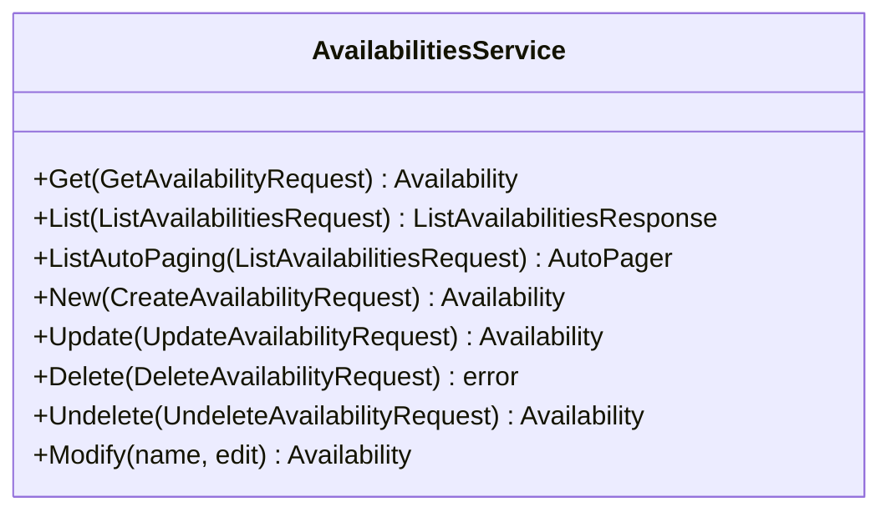

<!-- Code generated by protoc-gen-sdk 0.1.1. DO NOT EDIT. -->
# client.Availabilities

Availabilities manages when a calendar's owner may be scheduled.

RFC 7953 defines VAVAILABILITY as calendar data, not as an access protocol,
so these are the AIP-131..135 standard methods and nothing else. Serialising
one to an .ics file is not an Availability-specific concern -- see
protobuf.shared.interchange.v1.Interchange, which does it for any resource
type.

Reading these back through free-busy is deliberately elsewhere. RFC 7953
section 5 <https://www.rfc-editor.org/rfc/rfc7953.html#section-5> layers availability under events, so a free-busy reply is
computed from both; that lives on
protobuf.rfc5545.calendar.v1's Calendars.QueryFreeBusy, which owns the
calendar. Splitting it that way is forced -- AIP-215 <https://aip.dev/215> permits no
cross-package message reference, so neither package can name the other's
types.

`client.Availabilities` is a `AvailabilitiesService` over `protobuf.rfc7953.availability.v1.Availabilities`.




## Get

```go
func (s *AvailabilitiesService) Get(ctx context.Context, params *availabilitypb.GetAvailabilityRequest, opts ...option.RequestOption) (*availabilitypb.Availability, error)
```

Calls `protobuf.rfc7953.availability.v1.Availabilities.GetAvailability` (`GET /v1/{name=calendars/*/availabilities/*}`).

Retrieves one availability.

  GET /v1/{name=calendars/*/availabilities/*}

Safe and idempotent. Read the `etag` here and pass it back on update or
delete to make the write conditional.

  NOT_FOUND          no such availability, or it is soft-deleted and `show_deleted` was not set
  INVALID_ARGUMENT   name does not match calendars/*/availabilities/*
  PERMISSION_DENIED  caller may not read it

| Field | Type | Required | |
|---|---|---|---|
| `Name` | `string` | yes | // Name of the availability to retrieve. |

```go
availability, err := client.Availabilities.Get(ctx, &availabilitypb.GetAvailabilityRequest{
	Name: "calendars/my-calendar/availabilities/my-availabilitie",
})
if err != nil {
	return err
}
fmt.Println(availability.String())
```

## List

```go
func (s *AvailabilitiesService) List(ctx context.Context, params *availabilitypb.ListAvailabilitiesRequest, opts ...option.RequestOption) (*availabilitypb.ListAvailabilitiesResponse, error)
```

Returns one page. `ListAutoPaging` takes the same params and returns an
`*AutoPager` over every item.

Calls `protobuf.rfc7953.availability.v1.Availabilities.ListAvailabilities` (`GET /v1/{parent=calendars/*}/availabilities`).

Lists a calendar's availabilities.

  GET /v1/{parent=calendars/*}/availabilities

Paginated per AIP-158: pass `page_size` (defaults to 50, capped at 1000)
and the `next_page_token` from the previous response. Page tokens are
opaque and may expire; do not construct or store them.

Overlap is permitted and expected -- a general working-week pattern and a
one-off exception may both apply, and `priority` decides which wins,
RFC 7953 section 3.1 <https://www.rfc-editor.org/rfc/rfc7953.html#section-3.1>. This method returns them all; it does not
resolve them.

  INVALID_ARGUMENT   malformed filter, or page_size out of range
  PERMISSION_DENIED  caller may not list this collection

| Field | Type | Required | |
|---|---|---|---|
| `Parent` | `string` | yes | // Calendar whose availabilities to list, "calendars/{calendar}". |
| `PageSize` | `int32` |  | // Maximum availabilities to return. |
| `PageToken` | `string` |  | // Page token from a previous ListAvailabilitiesResponse.next_page_token. |
| `Filter` | `string` |  | // Filter expression, AIP-160 <https://aip.dev/160>. |
| `ShowDeleted` | `bool` |  | // Include soft-deleted availabilities in the result. |

```go
for availability, err := range client.Availabilities.ListAutoPaging(ctx, &availabilitypb.ListAvailabilitiesRequest{
	Parent: "calendars/my-calendar",
}).All() {
	if err != nil {
		return err
	}
	fmt.Println(availability.String())
}
```

## New

```go
func (s *AvailabilitiesService) New(ctx context.Context, params *availabilitypb.CreateAvailabilityRequest, opts ...option.RequestOption) (*availabilitypb.Availability, error)
```

Calls `protobuf.rfc7953.availability.v1.Availabilities.CreateAvailability` (`POST /v1/{parent=calendars/*}/availabilities`).

Creates an availability.

  POST /v1/{parent=calendars/*}/availabilities
  body: the availability itself

Server-assigned fields on the request body are ignored: `name`, `uid`,
`etag` and the timestamps are set by the server regardless of what is
sent. Supply `availability_id` to choose the final path segment.

Note the polarity, RFC 7953 section 3.1 <https://www.rfc-editor.org/rfc/rfc7953.html#section-3.1>: creating one declares its
whole range **unavailable**, and each AvailablePeriod inside it carves
out time that is not. An Availability with no periods is valid and means
"never schedulable in this range".

Not idempotent. Retrying after a timeout may create a second
availability; supply `availability_id` if the caller needs retry safety.

  ALREADY_EXISTS     that availability_id is taken
  INVALID_ARGUMENT   a field violates its buf.validate constraint
  PERMISSION_DENIED  caller may not create here

| Field | Type | Required | |
|---|---|---|---|
| `Parent` | `string` | yes | // Calendar to create the availability in, "calendars/{calendar}". |
| `Availability` | `*availabilitypb.Availability` | yes | // The availability to create. |
| `AvailabilityId` | `string` |  | // Client-assigned id, becoming the last segment of the resource name. |

```go
availability, err := client.Availabilities.New(ctx, &availabilitypb.CreateAvailabilityRequest{
	Parent: "calendars/my-calendar",
	Availability: &availabilitypb.Availability{},
})
if err != nil {
	return err
}
fmt.Println(availability.String())
```

## Update

```go
func (s *AvailabilitiesService) Update(ctx context.Context, params *availabilitypb.UpdateAvailabilityRequest, opts ...option.RequestOption) (*availabilitypb.Availability, error)
```

Calls `protobuf.rfc7953.availability.v1.Availabilities.UpdateAvailability` (`PATCH /v1/{availability.name=calendars/*/availabilities/*}`).

Updates an availability.

  PATCH /v1/{availability.name=calendars/*/availabilities/*}
  body: the availability itself

A partial update: only fields named in `update_mask` are written. An
empty mask writes every mutable field, which will clear anything the
caller left unset -- pass a mask unless that is the intent.

`available_periods` is replaced wholesale when the mask names it, not
merged: the periods are positional value objects with no identity of
their own, so there is nothing to match an incoming one against.

Idempotent. Pass the `etag` read from Get to make the write conditional.

  NOT_FOUND          no such availability
  ABORTED            etag does not match the stored resource
  INVALID_ARGUMENT   mask names an unknown or immutable field
  PERMISSION_DENIED  caller may not modify it

| Field | Type | Required | |
|---|---|---|---|
| `Availability` | `*availabilitypb.Availability` | yes | // The availability to update. |
| `UpdateMask` | `*fieldmaskpb.FieldMask` |  | // Fields to update. |

```go
availability, err := client.Availabilities.Update(ctx, &availabilitypb.UpdateAvailabilityRequest{
	Availability: &availabilitypb.Availability{},
})
if err != nil {
	return err
}
fmt.Println(availability.String())
```

## Delete

```go
func (s *AvailabilitiesService) Delete(ctx context.Context, params *availabilitypb.DeleteAvailabilityRequest, opts ...option.RequestOption) error
```

Calls `protobuf.rfc7953.availability.v1.Availabilities.DeleteAvailability` (`DELETE /v1/{name=calendars/*/availabilities/*}`).

Deletes an availability.

  DELETE /v1/{name=calendars/*/availabilities/*}

Soft delete: it is marked deleted, disappears from List unless
`show_deleted` is set, and is purged at `expire_time`. Recover it with
Undelete before then.

Deleting one makes its range fall back to whatever other availabilities
say, or to no constraint at all if it was the last -- which is more
permissive, not less. That asymmetry is worth a confirmation step in any
interface built on this.

  NOT_FOUND          no such availability
  ABORTED            etag does not match
  PERMISSION_DENIED  caller may not delete it

| Field | Type | Required | |
|---|---|---|---|
| `Name` | `string` | yes | // Name of the availability to delete. |

```go
if err := client.Availabilities.Delete(ctx, &availabilitypb.DeleteAvailabilityRequest{
	Name: "calendars/my-calendar/availabilities/my-availabilitie",
}); err != nil {
	return err
}
```

## Undelete

```go
func (s *AvailabilitiesService) Undelete(ctx context.Context, params *availabilitypb.UndeleteAvailabilityRequest, opts ...option.RequestOption) (*availabilitypb.Availability, error)
```

Calls `protobuf.rfc7953.availability.v1.Availabilities.UndeleteAvailability` (`POST /v1/{name=calendars/*/availabilities/*}:undelete`).

Restores a soft-deleted availability.

  POST /v1/{name=calendars/*/availabilities/*}:undelete

Valid only before `expire_time`; after that it is gone and this returns
NOT_FOUND.

  NOT_FOUND          no such availability, or already purged
  ALREADY_EXISTS     the availability is not deleted
  PERMISSION_DENIED  caller may not restore it

| Field | Type | Required | |
|---|---|---|---|
| `Name` | `string` | yes | // Name of the soft-deleted availability to restore. |

```go
availability, err := client.Availabilities.Undelete(ctx, &availabilitypb.UndeleteAvailabilityRequest{
	Name: "calendars/my-calendar/availabilities/my-availabilitie",
})
if err != nil {
	return err
}
fmt.Println(availability.String())
```
