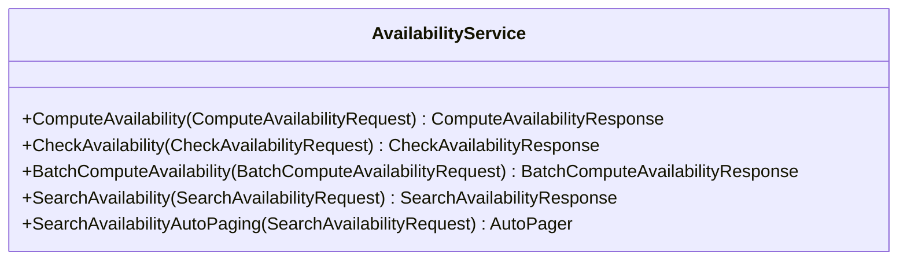

<!-- Code generated by protoc-gen-sdk dev. DO NOT EDIT. -->
# client.Availability

AllocationService is the read-only half of the engine: it answers how much is
free, and never changes anything. HoldService is the half that takes.

The counting is done here rather than stored anywhere. No RFC models an
inventory count -- RFC 5545 and RFC 7953 are one-calendar-one-timeline -- so
"5 of 12 free" is produced by asking each RFC 9073 resource's calendar
whether it is free across the window and totalling the answers. RFC 7953's
VAVAILABILITY says when a resource was on offer at all; bookings on its
calendar say what has since been taken; the difference is availability.

Every operation is a custom method (AIP-136): they compute rather than fetch,
so they take neither the standard-method names nor their shapes.

`client.Availability` is a `AvailabilityService` over `freebusy.allocation.v1.AllocationService`.




## ComputeAvailability

```go
func (s *AvailabilityService) ComputeAvailability(ctx context.Context, params *allocationpb.ComputeAvailabilityRequest, opts ...option.RequestOption) (*allocationpb.ComputeAvailabilityResponse, error)
```

Calls `freebusy.allocation.v1.AllocationService.ComputeAvailability` (`POST /v1/{parent=organizationalUnits/*}:computeAvailability`).

Computes availability across a site's resources, bucketed by slot or day.

| Field | Type | Required | |
|---|---|---|---|
| `Parent` | `string` | yes | // The site whose resources to compute over. |
| `Resources` | `[]string` |  | // Restrict the computation to these resources. |
| `Window` | `*interval.Interval` | yes | // The window to compute over. |
| `Granularity` | `allocationpb.AvailabilityGranularity` |  | // How to slice the window. |
| `SlotDuration` | `*durationpb.Duration` |  | // Slot length for SLOT granularity. |
| `TimeZone` | `string` |  | // IANA time zone the day boundaries are drawn in, e.g. |
| `IncludeFreeResources` | `bool` |  | // Populate AvailabilityBucket.free_resources. |
| `Filter` | `string` |  | // An AIP-160 filter over each resource's search record (ResourceDay): its // `resource_types`, its STRUCTURED-DATA under `attributes` (any path, e.g. |

```go
computeAvailabilityResponse, err := client.Availability.ComputeAvailability(ctx, &allocationpb.ComputeAvailabilityRequest{
	Parent: "organizationalUnits/my-organizational-unit",
	Window: &interval.Interval{StartTime: timestamppb.Now(), EndTime: timestamppb.New(time.Now().Add(time.Hour))},
})
if err != nil {
	return err
}
fmt.Println(computeAvailabilityResponse.String())
```

## CheckAvailability

```go
func (s *AvailabilityService) CheckAvailability(ctx context.Context, params *allocationpb.CheckAvailabilityRequest, opts ...option.RequestOption) (*allocationpb.CheckAvailabilityResponse, error)
```

Calls `freebusy.allocation.v1.AllocationService.CheckAvailability` (`POST /v1/{parent=organizationalUnits/*}:checkAvailability`).

Checks one exact window for one exact quantity, with reasons when it fails.

Advisory, not a reservation: the answer can be stale the instant it is
returned. CreateHold is what actually secures anything.

| Field | Type | Required | |
|---|---|---|---|
| `Parent` | `string` | yes | // The site whose resources to check. |
| `Resources` | `[]string` |  | // Restrict the check to these resources. |
| `Window` | `*interval.Interval` | yes | // The exact window to check. |
| `Quantity` | `int32` |  | // How many resources are needed. |
| `Filter` | `string` |  | // An AIP-160 filter over each resource's search record (ResourceDay): its // `resource_types`, its STRUCTURED-DATA under `attributes` (any path, e.g. |

```go
checkAvailabilityResponse, err := client.Availability.CheckAvailability(ctx, &allocationpb.CheckAvailabilityRequest{
	Parent: "organizationalUnits/my-organizational-unit",
	Window: &interval.Interval{StartTime: timestamppb.Now(), EndTime: timestamppb.New(time.Now().Add(time.Hour))},
})
if err != nil {
	return err
}
fmt.Println(checkAvailabilityResponse.String())
```

## BatchComputeAvailability

```go
func (s *AvailabilityService) BatchComputeAvailability(ctx context.Context, params *allocationpb.BatchComputeAvailabilityRequest, opts ...option.RequestOption) (*allocationpb.BatchComputeAvailabilityResponse, error)
```

Calls `freebusy.allocation.v1.AllocationService.BatchComputeAvailability` (`POST /v1/resources:batchCompute`).

Runs several availability computations in one round trip.

Each entry is independent and may name a different site, window or
granularity. Capped at 50 entries, because each one fans out across every
candidate resource's calendar.

| Field | Type | Required | |
|---|---|---|---|
| `Requests` | `[]*allocationpb.ComputeAvailabilityRequest` | yes | // The computations to run. |

```go
batchComputeAvailabilityResponse, err := client.Availability.BatchComputeAvailability(ctx, &allocationpb.BatchComputeAvailabilityRequest{
	Requests: []*allocationpb.ComputeAvailabilityRequest{{
		Parent: "parent",
		Window: &interval.Interval{StartTime: timestamppb.Now(), EndTime: timestamppb.New(time.Now().Add(time.Hour))},
	}},
})
if err != nil {
	return err
}
fmt.Println(batchComputeAvailabilityResponse.String())
```

## SearchAvailability

```go
func (s *AvailabilityService) SearchAvailability(ctx context.Context, params *allocationpb.SearchAvailabilityRequest, opts ...option.RequestOption) (*allocationpb.SearchAvailabilityResponse, error)
```

Returns one page. `SearchAvailabilityAutoPaging` takes the same params and returns an
`*AutoPager` over every item.

Calls `freebusy.allocation.v1.AllocationService.SearchAvailability` (`POST /v1/{parent=organizations/*}:searchAvailability`).

Sweeps an operator for resources free across a window.

The search entry point, where ComputeAvailability answers for a site the
caller has already chosen. Paginated, since a large operator may match
thousands of resources.

| Field | Type | Required | |
|---|---|---|---|
| `Parent` | `string` | yes | // The operator to search within. |
| `Window` | `*interval.Interval` | yes | // The window that must be free. |
| `OrganizationalUnits` | `[]string` |  | // Restrict to sites, e.g. |
| `ResourceTypes` | `[]string` |  | // Restrict to RESOURCE-TYPE values, RFC 9073 section 6.3, e.g. |
| `Quantity` | `int32` |  | // How many resources must be free together at one site for it to match. |
| `PageSize` | `int32` |  | // Maximum matches to return. |
| `PageToken` | `string` |  | // Page token from a previous SearchAvailabilityResponse.next_page_token. |
| `Filter` | `string` |  | // An AIP-160 filter over each resource's search record (ResourceDay): its // `resource_types`, its STRUCTURED-DATA under `attributes` (any path, e.g. |
| `OrderBy` | `string` |  | // AIP-132 order of the matches: a comma-separated list of `resource`, // `organizational_unit`, `display_name`, `free_fraction` (the share of // the window's first UTC day that is free) and `attributes.max_occupancy` // (the booking profile's, as a number), each optionally followed by // ` desc`, e.g. |
| `Facets` | `[]string` |  | // Fields to count matching resources by, returned in // SearchAvailabilityResponse.facets: `resource_types`, // `organizational_unit` or an `attributes.<path>`, e.g. |

```go
for availabilityMatch, err := range client.Availability.SearchAvailabilityAutoPaging(ctx, &allocationpb.SearchAvailabilityRequest{
	Parent: "organizations/my-organization",
	Window: &interval.Interval{StartTime: timestamppb.Now(), EndTime: timestamppb.New(time.Now().Add(time.Hour))},
}).All() {
	if err != nil {
		return err
	}
	fmt.Println(availabilityMatch.String())
}
```
