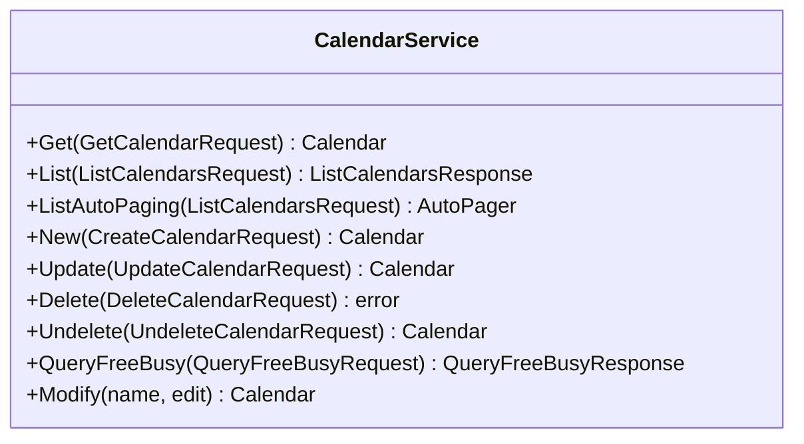

<!-- Code generated by protoc-gen-sdk dev. DO NOT EDIT. -->
# client.Calendars

Calendars manages the collections that Events belong to, RFC 5545
section 3.4 <https://www.rfc-editor.org/rfc/rfc5545.html#section-3.4>.

Events are managed by protobuf.rfc5545.event.v1.Events, a separate service
in its own package. Deleting a calendar therefore affects a resource this
service cannot see, which is why DeleteCalendar requires force rather than
cascading silently.

AIP-131..135 also happens to cover most of CalDAV, RFC 4791: MKCALENDAR
(section 5.3.1 <https://www.rfc-editor.org/rfc/rfc4791.html#section-5.3.1>) is CreateCalendar; the calendar-query REPORT's time-range
filter (section 7.8 <https://www.rfc-editor.org/rfc/rfc4791.html#section-7.8>) is ListEvents' AIP-160 filter over start/end; and
If-Match concurrency (section 5.3.4 <https://www.rfc-editor.org/rfc/rfc4791.html#section-5.3.4>) is the `etag` every resource already
carries, AIP-154 <https://aip.dev/154>. QueryFreeBusy is the one CalDAV capability with no
standard-method equivalent.

`client.Calendars` is a `CalendarService` over `protobuf.rfc5545.calendar.v1.Calendars`.




## Get

```go
func (s *CalendarService) Get(ctx context.Context, params *calendarpb.GetCalendarRequest, opts ...option.RequestOption) (*calendarpb.Calendar, error)
```

Calls `protobuf.rfc5545.calendar.v1.Calendars.GetCalendar` (`GET /v1/{name=calendars/*}`).

Retrieves one calendar.

  GET /v1/{name=calendars/*}

Safe and idempotent. Returns the resource as stored; no field is computed
per-caller. Read the `etag` here and pass it back on update or delete to
make the write conditional.

  NOT_FOUND          no such calendar, or it is soft-deleted and `show_deleted` was not set
  INVALID_ARGUMENT   name does not match calendars/*
  PERMISSION_DENIED  caller may not read it

| Field | Type | Required | |
|---|---|---|---|
| `Name` | `string` | yes | // Name of the calendar to retrieve, "calendars/{calendar}". |

```go
calendar, err := client.Calendars.Get(ctx, &calendarpb.GetCalendarRequest{
	Name: "calendars/my-calendar",
})
if err != nil {
	return err
}
fmt.Println(calendar.String())
```

## List

```go
func (s *CalendarService) List(ctx context.Context, params *calendarpb.ListCalendarsRequest, opts ...option.RequestOption) (*calendarpb.ListCalendarsResponse, error)
```

Returns one page. `ListAutoPaging` takes the same params and returns an
`*AutoPager` over every item.

Calls `protobuf.rfc5545.calendar.v1.Calendars.ListCalendars` (`GET /v1/calendars`).

Lists calendars.

  GET /v1/calendars

Paginated per AIP-158: pass `page_size` (defaults to 50, capped at 1000)
and the `next_page_token` from the previous response. An empty
`next_page_token` means the last page. Page tokens are opaque and may
expire; do not construct or store them.

Filtering uses the AIP-160 expression language over the resource's own
fields. Results carry no guaranteed order.

  INVALID_ARGUMENT   malformed filter, or page_size out of range
  PERMISSION_DENIED  caller may not list this collection

| Field | Type | Required | |
|---|---|---|---|
| `PageSize` | `int32` |  | // Maximum calendars to return. |
| `PageToken` | `string` |  | // Page token from a previous ListCalendarsResponse.next_page_token. |
| `Filter` | `string` |  | // Filter expression, AIP-160 <https://aip.dev/160>. |
| `ShowDeleted` | `bool` |  | // Include soft-deleted calendars in the result. |

```go
for calendar, err := range client.Calendars.ListAutoPaging(ctx, &calendarpb.ListCalendarsRequest{}).All() {
	if err != nil {
		return err
	}
	fmt.Println(calendar.String())
}
```

## New

```go
func (s *CalendarService) New(ctx context.Context, params *calendarpb.CreateCalendarRequest, opts ...option.RequestOption) (*calendarpb.Calendar, error)
```

Calls `protobuf.rfc5545.calendar.v1.Calendars.CreateCalendar` (`POST /v1/calendars`).

Creates a calendar.

  POST /v1/calendars
  body: the calendar itself

Server-assigned fields on the request body are ignored: `name`, `uid`,
`etag` and the timestamps are set by the server regardless of what is
sent. Supply `calendar_id` to choose the final path segment; leave it empty
and the server generates one.

Not idempotent. Retrying after a timeout may create a second calendar;
supply `calendar_id` if the caller needs retry safety.

  ALREADY_EXISTS     that calendar_id is taken
  INVALID_ARGUMENT   a field violates its buf.validate constraint
  PERMISSION_DENIED  caller may not create here

| Field | Type | Required | |
|---|---|---|---|
| `Calendar` | `*calendarpb.Calendar` | yes | // The calendar to create. |
| `CalendarId` | `string` |  | // Client-assigned id, becoming the last segment of the resource name. |

```go
calendar, err := client.Calendars.New(ctx, &calendarpb.CreateCalendarRequest{
	Calendar: &calendarpb.Calendar{
		DisplayName: "display-name",
	},
})
if err != nil {
	return err
}
fmt.Println(calendar.String())
```

## Update

```go
func (s *CalendarService) Update(ctx context.Context, params *calendarpb.UpdateCalendarRequest, opts ...option.RequestOption) (*calendarpb.Calendar, error)
```

Calls `protobuf.rfc5545.calendar.v1.Calendars.UpdateCalendar` (`PATCH /v1/{calendar.name=calendars/*}`).

Updates a calendar.

  PATCH /v1/{calendar.name=calendars/*}
  body: the calendar itself

A partial update: only fields named in `update_mask` are written. An
empty mask writes every mutable field, which will clear anything the
caller left unset -- pass a mask unless that is the intent. OUTPUT_ONLY
and IMMUTABLE fields are rejected rather than silently dropped.

Idempotent. Pass the `etag` read from Get to make the write conditional.

  NOT_FOUND          no such calendar
  ABORTED            etag does not match the stored resource
  INVALID_ARGUMENT   mask names an unknown or immutable field
  PERMISSION_DENIED  caller may not modify it

| Field | Type | Required | |
|---|---|---|---|
| `Calendar` | `*calendarpb.Calendar` | yes | // The calendar to update. |
| `UpdateMask` | `*fieldmaskpb.FieldMask` |  | // Fields to update. |

```go
calendar, err := client.Calendars.Update(ctx, &calendarpb.UpdateCalendarRequest{
	Calendar: &calendarpb.Calendar{
		DisplayName: "display-name",
	},
})
if err != nil {
	return err
}
fmt.Println(calendar.String())
```

## Delete

```go
func (s *CalendarService) Delete(ctx context.Context, params *calendarpb.DeleteCalendarRequest, opts ...option.RequestOption) error
```

Calls `protobuf.rfc5545.calendar.v1.Calendars.DeleteCalendar` (`DELETE /v1/{name=calendars/*}`).

Deletes a calendar.

  DELETE /v1/{name=calendars/*}

Soft delete: the calendar is marked deleted, disappears from List unless
`show_deleted` is set, and is purged at `expire_time`. Recover it with
Undelete before then.

Idempotent in effect but not in reporting: a second delete returns
NOT_FOUND rather than succeeding silently.

  NOT_FOUND          no such calendar
  ABORTED            etag does not match
  FAILED_PRECONDITION  it still has children and `force` was not set
  PERMISSION_DENIED  caller may not delete it

| Field | Type | Required | |
|---|---|---|---|
| `Name` | `string` | yes | // Name of the calendar to delete, "calendars/{calendar}". |
| `Force` | `bool` |  | // Delete the calendar's events along with it. |

```go
if err := client.Calendars.Delete(ctx, &calendarpb.DeleteCalendarRequest{
	Name: "calendars/my-calendar",
}); err != nil {
	return err
}
```

## Undelete

```go
func (s *CalendarService) Undelete(ctx context.Context, params *calendarpb.UndeleteCalendarRequest, opts ...option.RequestOption) (*calendarpb.Calendar, error)
```

Calls `protobuf.rfc5545.calendar.v1.Calendars.UndeleteCalendar` (`POST /v1/{name=calendars/*}:undelete`).

Restores a soft-deleted calendar.

  POST /v1/{name=calendars/*}:undelete

Valid only before `expire_time`; after that the calendar is gone and this
returns NOT_FOUND. Clears `delete_time` and `expire_time` and returns the
calendar as it was.

  NOT_FOUND          no such calendar, or already purged
  ALREADY_EXISTS     the calendar is not deleted
  PERMISSION_DENIED  caller may not restore it

| Field | Type | Required | |
|---|---|---|---|
| `Name` | `string` | yes | // Name of the soft-deleted calendar to restore. |

```go
calendar, err := client.Calendars.Undelete(ctx, &calendarpb.UndeleteCalendarRequest{
	Name: "calendars/my-calendar",
})
if err != nil {
	return err
}
fmt.Println(calendar.String())
```

## QueryFreeBusy

```go
func (s *CalendarService) QueryFreeBusy(ctx context.Context, params *calendarpb.QueryFreeBusyRequest, opts ...option.RequestOption) (*calendarpb.QueryFreeBusyResponse, error)
```

Calls `protobuf.rfc5545.calendar.v1.Calendars.QueryFreeBusy` (`POST /v1/{name=calendars/*}:query`).

Reports busy periods for a calendar over a time window, without
returning the events themselves, RFC 4791 section 7.10 <https://www.rfc-editor.org/rfc/rfc4791.html#section-7.10> (the
free-busy-query REPORT).

  POST /v1/{name=calendars/*}:query
  body: the whole request message

A custom method, not List with a projection: RFC 4791 grants
CALDAV:read-free-busy independently of read access to the events
themselves, section 6.1.1 <https://www.rfc-editor.org/rfc/rfc4791.html#section-6.1.1> -- a caller who may see only availability must
never be handed the underlying Event.

  NOT_FOUND          no such calendar
  INVALID_ARGUMENT   window.end_time is not after window.start_time
  PERMISSION_DENIED  caller may not read free/busy for this calendar

| Field | Type | Required | |
|---|---|---|---|
| `Name` | `string` | yes | // The calendar to query, "calendars/{calendar}". |
| `Window` | `*interval.Interval` | yes | // The window to report busy periods within. |

```go
queryFreeBusyResponse, err := client.Calendars.QueryFreeBusy(ctx, &calendarpb.QueryFreeBusyRequest{
	Name: "calendars/my-calendar",
	Window: &interval.Interval{StartTime: timestamppb.Now(), EndTime: timestamppb.New(time.Now().Add(time.Hour))},
})
if err != nil {
	return err
}
fmt.Println(queryFreeBusyResponse.String())
```
