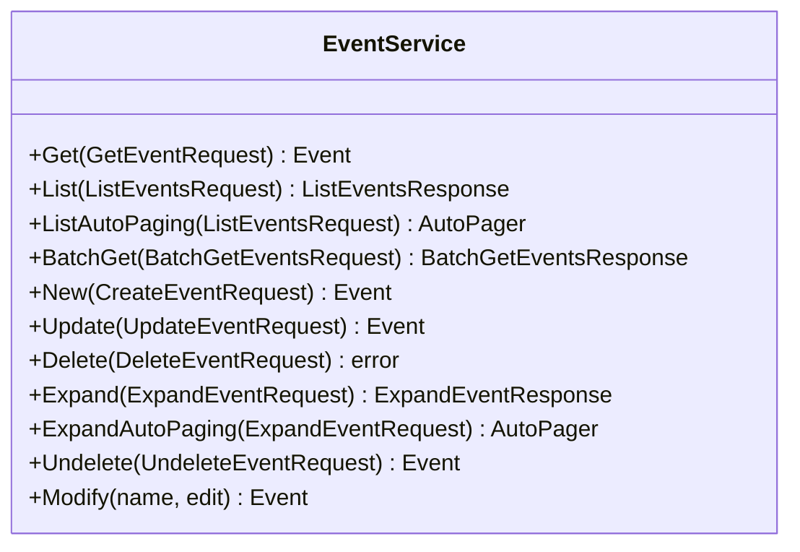

<!-- Code generated by protoc-gen-sdk 0.1.1. DO NOT EDIT. -->
# client.Events

Events manages RFC 5545 events as resources.

Named Events, not Calendar: the calendar an event belongs to is its own
resource, managed by protobuf.rfc5545.calendar.v1.Calendars. A service
named after the parent while managing the child is how a reader ends up
looking for CreateCalendar here.

AIP-131..135 plus one custom method. ExpandEvent earns its place where
Export did not: expansion is specific to recurring events and cannot be
generalised across resource types, whereas serialising to a file can --
that lives in protobuf.shared.interchange.v1.Interchange.

`client.Events` is a `EventService` over `protobuf.rfc5545.event.v1.Events`.




## Get

```go
func (s *EventService) Get(ctx context.Context, params *eventpb.GetEventRequest, opts ...option.RequestOption) (*eventpb.Event, error)
```

Calls `protobuf.rfc5545.event.v1.Events.GetEvent` (`GET /v1/{name=calendars/*/events/*}`).

Retrieves one event.

  GET /v1/{name=calendars/*/events/*}

Safe and idempotent. Returns the resource as stored; no field is computed
per-caller. Read the `etag` here and pass it back on update or delete to
make the write conditional.

  NOT_FOUND          no such event, or it is soft-deleted and `show_deleted` was not set
  INVALID_ARGUMENT   name does not match calendars/*/events/*
  PERMISSION_DENIED  caller may not read it

| Field | Type | Required | |
|---|---|---|---|
| `Name` | `string` | yes | // Name of the event, "calendars/{calendar}/events/{event}". |

```go
event, err := client.Events.Get(ctx, &eventpb.GetEventRequest{
	Name: "calendars/my-calendar/events/my-event",
})
if err != nil {
	return err
}
fmt.Println(event.String())
```

## List

```go
func (s *EventService) List(ctx context.Context, params *eventpb.ListEventsRequest, opts ...option.RequestOption) (*eventpb.ListEventsResponse, error)
```

Returns one page. `ListAutoPaging` takes the same params and returns an
`*AutoPager` over every item.

Calls `protobuf.rfc5545.event.v1.Events.ListEvents` (`GET /v1/{parent=calendars/*}/events`).

Lists events.

  GET /v1/{parent=calendars/*}/events

Paginated per AIP-158: pass `page_size` (defaults to 50, capped at 1000)
and the `next_page_token` from the previous response. An empty
`next_page_token` means the last page. Page tokens are opaque and may
expire; do not construct or store them.

Filtering uses the AIP-160 expression language over the resource's own
fields. Results carry no guaranteed order.

Returns stored events, one per recurrence rule -- listing does not
expand recurrences. An unbounded rule has infinitely many instances, so
expansion needs a window and lives in ExpandEvent.

  INVALID_ARGUMENT   malformed filter, or page_size out of range
  PERMISSION_DENIED  caller may not list this collection

| Field | Type | Required | |
|---|---|---|---|
| `Parent` | `string` | yes | // Calendar whose events to list, "calendars/{calendar}". |
| `PageSize` | `int32` |  | // Maximum events to return. |
| `PageToken` | `string` |  | // Page token from a previous ListEventsResponse.next_page_token. |
| `Filter` | `string` |  | // Filter expression, AIP-160 <https://aip.dev/160>. |
| `ShowDeleted` | `bool` |  | // Include soft-deleted events in the result. |

```go
for event, err := range client.Events.ListAutoPaging(ctx, &eventpb.ListEventsRequest{
	Parent: "calendars/my-calendar",
}).All() {
	if err != nil {
		return err
	}
	fmt.Println(event.String())
}
```

## BatchGet

```go
func (s *EventService) BatchGet(ctx context.Context, params *eventpb.BatchGetEventsRequest, opts ...option.RequestOption) (*eventpb.BatchGetEventsResponse, error)
```

Calls `protobuf.rfc5545.event.v1.Events.BatchGetEvents` (`GET /v1/{parent=calendars/*}/events:batchGet`).

Retrieves several events by name in one call.

  GET /v1/{parent=calendars/*}/events:batchGet

CALDAV:calendar-multiget, RFC 4791 section 7.9 <https://www.rfc-editor.org/rfc/rfc4791.html#section-7.9>: a client that has
synchronised a collection holds hrefs and wants the bodies, which is one
round trip here instead of one GET per event.

Safe and idempotent. Events come back in the order requested, per
AIP-231 <https://aip.dev/231>. All-or-nothing: an unreadable or missing name fails the whole
call rather than returning a short list, so a caller never has to work out
which name a gap belonged to.

  NOT_FOUND          any requested event does not exist
  INVALID_ARGUMENT   a name is malformed, sits under a different parent, or the list is empty or over 1000
  PERMISSION_DENIED  caller may not read any one of them

| Field | Type | Required | |
|---|---|---|---|
| `Parent` | `string` | yes | // Calendar the events belong to, "calendars/{calendar}". |
| `Names` | `[]string` | yes | // Names of the events to retrieve, each // "calendars/{calendar}/events/{event}". |

```go
batchGetEventsResponse, err := client.Events.BatchGet(ctx, &eventpb.BatchGetEventsRequest{
	Parent: "calendars/my-calendar",
	Names: []string{"calendars/my-calendar/events/my-event"},
})
if err != nil {
	return err
}
fmt.Println(batchGetEventsResponse.String())
```

## New

```go
func (s *EventService) New(ctx context.Context, params *eventpb.CreateEventRequest, opts ...option.RequestOption) (*eventpb.Event, error)
```

Calls `protobuf.rfc5545.event.v1.Events.CreateEvent` (`POST /v1/{parent=calendars/*}/events`).

Creates an event.

  POST /v1/{parent=calendars/*}/events
  body: the event itself

Server-assigned fields on the request body are ignored: `name`, `uid`,
`etag` and the timestamps are set by the server regardless of what is
sent. Supply `event_id` to choose the final path segment; leave it empty
and the server generates one.

Not idempotent. Retrying after a timeout may create a second event;
supply `event_id` if the caller needs retry safety.

  ALREADY_EXISTS     that event_id is taken
  INVALID_ARGUMENT   a field violates its buf.validate constraint
  PERMISSION_DENIED  caller may not create here

| Field | Type | Required | |
|---|---|---|---|
| `Parent` | `string` | yes | // Calendar to create the event in, "calendars/{calendar}". |
| `Event` | `*eventpb.Event` | yes | // The event to create. |
| `EventId` | `string` |  | // Client-assigned id, becoming the last segment of the resource name. |

```go
event, err := client.Events.New(ctx, &eventpb.CreateEventRequest{
	Parent: "calendars/my-calendar",
	Event: &eventpb.Event{
		Start: &eventpb.CalendarTime{},
	},
})
if err != nil {
	return err
}
fmt.Println(event.String())
```

## Update

```go
func (s *EventService) Update(ctx context.Context, params *eventpb.UpdateEventRequest, opts ...option.RequestOption) (*eventpb.Event, error)
```

Calls `protobuf.rfc5545.event.v1.Events.UpdateEvent` (`PATCH /v1/{event.name=calendars/*/events/*}`).

Updates an event.

  PATCH /v1/{event.name=calendars/*/events/*}
  body: the event itself

A partial update: only fields named in `update_mask` are written. An
empty mask writes every mutable field, which will clear anything the
caller left unset -- pass a mask unless that is the intent. OUTPUT_ONLY
and IMMUTABLE fields are rejected rather than silently dropped.

Idempotent. Pass the `etag` read from Get to make the write conditional.

  NOT_FOUND          no such event
  ABORTED            etag does not match the stored resource
  INVALID_ARGUMENT   mask names an unknown or immutable field
  PERMISSION_DENIED  caller may not modify it

| Field | Type | Required | |
|---|---|---|---|
| `Event` | `*eventpb.Event` | yes | // The event to update. |
| `UpdateMask` | `*fieldmaskpb.FieldMask` |  | // Fields to update. |

```go
event, err := client.Events.Update(ctx, &eventpb.UpdateEventRequest{
	Event: &eventpb.Event{
		Start: &eventpb.CalendarTime{},
	},
})
if err != nil {
	return err
}
fmt.Println(event.String())
```

## Delete

```go
func (s *EventService) Delete(ctx context.Context, params *eventpb.DeleteEventRequest, opts ...option.RequestOption) error
```

Calls `protobuf.rfc5545.event.v1.Events.DeleteEvent` (`DELETE /v1/{name=calendars/*/events/*}`).

Deletes an event.

  DELETE /v1/{name=calendars/*/events/*}

Soft delete: the event is marked deleted, disappears from List unless
`show_deleted` is set, and is purged at `expire_time`. Recover it with
Undelete before then.

Idempotent in effect but not in reporting: a second delete returns
NOT_FOUND rather than succeeding silently.

  NOT_FOUND          no such event
  ABORTED            etag does not match
  PERMISSION_DENIED  caller may not delete it

| Field | Type | Required | |
|---|---|---|---|
| `Name` | `string` | yes | // Name of the event to delete. |

```go
if err := client.Events.Delete(ctx, &eventpb.DeleteEventRequest{
	Name: "calendars/my-calendar/events/my-event",
}); err != nil {
	return err
}
```

## Expand

```go
func (s *EventService) Expand(ctx context.Context, params *eventpb.ExpandEventRequest, opts ...option.RequestOption) (*eventpb.ExpandEventResponse, error)
```

Returns one page. `ExpandAutoPaging` takes the same params and returns an
`*AutoPager` over every item.

Calls `protobuf.rfc5545.event.v1.Events.ExpandEvent` (`POST /v1/{name=calendars/*/events/*}:expand`).

Materialises the occurrences of a recurring event within a time window.

  POST /v1/{name=calendars/*/events/*}:expand
  body: the whole request message

A custom method (AIP-136) because expansion cannot be generalised across
resource types the way export can -- only a recurrence rule expands.

The window is a google.type.Interval and is required at both ends,
deliberately. A rule bounded by neither UNTIL nor COUNT generates
infinitely many instances, so there is no safe default and a missing
bound is a caller bug worth reporting rather than one the server guesses
around. The interval is half-open: instances at `start_time` are
included, instances at `end_time` are not.

Returns materialised instances with EXDATE exclusions removed and RDATE
additions folded in. None is a stored resource, so none carries a
resource name and none can be passed to Get, Update or Delete -- edit the
series through its stored event instead.

Paginated like List, with its own `page_size` default of 250.

  NOT_FOUND          no such event
  INVALID_ARGUMENT   window.end_time is not after window.start_time
  FAILED_PRECONDITION  the event has no recurrence rule
  PERMISSION_DENIED  caller may not read it

| Field | Type | Required | |
|---|---|---|---|
| `Name` | `string` | yes | // The recurring event to expand. |
| `Window` | `*interval.Interval` | yes | // The time window to expand over: instances starting at or after // `start_time` and strictly before `end_time`. |
| `PageSize` | `int32` |  | // Maximum instances to return. |
| `PageToken` | `string` |  | // Page token from a previous ExpandEventResponse.next_page_token. |

```go
for event, err := range client.Events.ExpandAutoPaging(ctx, &eventpb.ExpandEventRequest{
	Name: "calendars/my-calendar/events/my-event",
	Window: &interval.Interval{StartTime: timestamppb.Now(), EndTime: timestamppb.New(time.Now().Add(time.Hour))},
}).All() {
	if err != nil {
		return err
	}
	fmt.Println(event.String())
}
```

## Undelete

```go
func (s *EventService) Undelete(ctx context.Context, params *eventpb.UndeleteEventRequest, opts ...option.RequestOption) (*eventpb.Event, error)
```

Calls `protobuf.rfc5545.event.v1.Events.UndeleteEvent` (`POST /v1/{name=calendars/*/events/*}:undelete`).

Restores a soft-deleted event.

  POST /v1/{name=calendars/*/events/*}:undelete

Valid only before `expire_time`; after that the event is gone and this
returns NOT_FOUND. Clears `delete_time` and `expire_time` and returns the
event as it was.

  NOT_FOUND          no such event, or already purged
  ALREADY_EXISTS     the event is not deleted
  PERMISSION_DENIED  caller may not restore it

| Field | Type | Required | |
|---|---|---|---|
| `Name` | `string` | yes | // Name of the soft-deleted event to restore, "calendars/{calendar}/events/{event}". |

```go
event, err := client.Events.Undelete(ctx, &eventpb.UndeleteEventRequest{
	Name: "calendars/my-calendar/events/my-event",
})
if err != nil {
	return err
}
fmt.Println(event.String())
```
