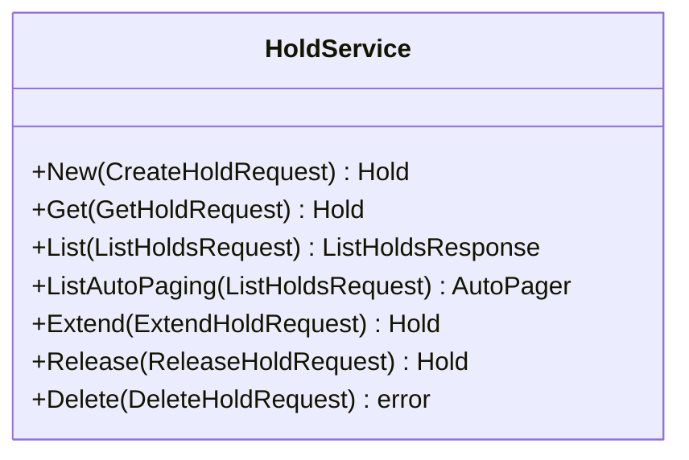

<!-- Code generated by protoc-gen-sdk dev. DO NOT EDIT. -->
# client.Holds

HoldService takes and releases expiring claims on resources. It is the only
thing in this API that mutates availability.

Two things are deliberately not RPCs: the sweeper that expires lapsed holds
is an internal job, not a call, and conversion to a confirmed booking is
driven by ReservationService, so a hold is never converted by a caller
reaching in here.

There is no UpdateHold. A hold's window and resources are immutable by
construction -- changing either is a different allocation -- so the only
mutations are the two custom methods below.

`client.Holds` is a `HoldService` over `freebusy.allocation.v1.HoldService`.




## New

```go
func (s *HoldService) New(ctx context.Context, params *allocationpb.CreateHoldRequest, opts ...option.RequestOption) (*allocationpb.Hold, error)
```

Calls `freebusy.allocation.v1.HoldService.CreateHold` (`POST /v1/{parent=organizationalUnits/*}/holds`).

Takes a hold, allocating concrete resources for the window.

The server chooses which resources are taken from the candidates offered,
under a lock, so two callers racing for the last bay cannot both win.
Requires an idempotency key: a retry after a timeout returns the original
hold rather than taking a second one.

| Field | Type | Required | |
|---|---|---|---|
| `Parent` | `string` | yes | // The site whose resources may be taken. |
| `Hold` | `*allocationpb.Hold` | yes | // The hold to take. |
| `HoldId` | `string` |  | // Client-assigned id, becoming the last segment of the hold name. |

```go
hold, err := client.Holds.New(ctx, &allocationpb.CreateHoldRequest{
	Parent: "organizationalUnits/my-organizational-unit",
	Hold: &allocationpb.Hold{
		Window: &interval.Interval{StartTime: timestamppb.Now(), EndTime: timestamppb.New(time.Now().Add(time.Hour))},
	},
})
if err != nil {
	return err
}
fmt.Println(hold.String())
```

## Get

```go
func (s *HoldService) Get(ctx context.Context, params *allocationpb.GetHoldRequest, opts ...option.RequestOption) (*allocationpb.Hold, error)
```

Calls `freebusy.allocation.v1.HoldService.GetHold` (`GET /v1/{name=organizationalUnits/*/holds/*}`).

Retrieves one hold.

Authoritative on expiry: a hold whose expire_time has passed is reported
EXPIRED here even if the sweeper has not yet written that state, so a
caller never sees an ACTIVE hold that no longer reserves anything.

| Field | Type | Required | |
|---|---|---|---|
| `Name` | `string` | yes | // Name of the hold to retrieve. |

```go
hold, err := client.Holds.Get(ctx, &allocationpb.GetHoldRequest{
	Name: "organizationalUnits/my-organizational-unit/holds/my-hold",
})
if err != nil {
	return err
}
fmt.Println(hold.String())
```

## List

```go
func (s *HoldService) List(ctx context.Context, params *allocationpb.ListHoldsRequest, opts ...option.RequestOption) (*allocationpb.ListHoldsResponse, error)
```

Returns one page. `ListAutoPaging` takes the same params and returns an
`*AutoPager` over every item.

Calls `freebusy.allocation.v1.HoldService.ListHolds` (`GET /v1/{parent=organizationalUnits/*}/holds`).

Lists the holds taken at a site.

| Field | Type | Required | |
|---|---|---|---|
| `Parent` | `string` | yes | // The site whose holds to list. |
| `PageSize` | `int32` |  | // Maximum holds to return. |
| `PageToken` | `string` |  | // Page token from a previous ListHoldsResponse.next_page_token. |
| `Filter` | `string` |  | // Filter expression, AIP-160, over the hold's own fields, e.g. |

```go
for hold, err := range client.Holds.ListAutoPaging(ctx, &allocationpb.ListHoldsRequest{
	Parent: "organizationalUnits/my-organizational-unit",
}).All() {
	if err != nil {
		return err
	}
	fmt.Println(hold.String())
}
```

## Extend

```go
func (s *HoldService) Extend(ctx context.Context, params *allocationpb.ExtendHoldRequest, opts ...option.RequestOption) (*allocationpb.Hold, error)
```

Calls `freebusy.allocation.v1.HoldService.ExtendHold` (`POST /v1/{name=organizationalUnits/*/holds/*}:extend`).

Pushes a hold's expiry further out.

Measured from now rather than from the current deadline, so repeated calls
cannot accumulate an unbounded reservation. Fails on a hold that is not
ACTIVE -- an expired hold is gone, not extendable.

| Field | Type | Required | |
|---|---|---|---|
| `Name` | `string` | yes | // Name of the hold to extend. |
| `Duration` | `*durationpb.Duration` | yes | // How much further out to push expire_time, measured from now rather than // from the current deadline, so repeated extensions cannot accumulate. |
| `Etag` | `string` |  | // Opaque version read from the hold; the extension is rejected if the hold // changed since (AIP-154). |

```go
hold, err := client.Holds.Extend(ctx, &allocationpb.ExtendHoldRequest{
	Name: "organizationalUnits/my-organizational-unit/holds/my-hold",
	Duration: durationpb.New(30 * time.Minute),
})
if err != nil {
	return err
}
fmt.Println(hold.String())
```

## Release

```go
func (s *HoldService) Release(ctx context.Context, params *allocationpb.ReleaseHoldRequest, opts ...option.RequestOption) (*allocationpb.Hold, error)
```

Calls `freebusy.allocation.v1.HoldService.ReleaseHold` (`POST /v1/{name=organizationalUnits/*/holds/*}:release`).

Gives a hold up before it expires, freeing its resources immediately.

Idempotent: releasing an already-released or expired hold succeeds and
changes nothing, because the caller's intent is already satisfied.

| Field | Type | Required | |
|---|---|---|---|
| `Name` | `string` | yes | // Name of the hold to release. |
| `Etag` | `string` |  | // Opaque version read from the hold; the release is rejected if the hold // changed since (AIP-154). |

```go
hold, err := client.Holds.Release(ctx, &allocationpb.ReleaseHoldRequest{
	Name: "organizationalUnits/my-organizational-unit/holds/my-hold",
})
if err != nil {
	return err
}
fmt.Println(hold.String())
```

## Delete

```go
func (s *HoldService) Delete(ctx context.Context, params *allocationpb.DeleteHoldRequest, opts ...option.RequestOption) error
```

Calls `freebusy.allocation.v1.HoldService.DeleteHold` (`DELETE /v1/{name=organizationalUnits/*/holds/*}`).

Deletes a hold record.

Housekeeping for terminal holds, not a way to free resources -- use
ReleaseHold for that. Deleting an ACTIVE hold is rejected, so inventory is
never freed by a path that leaves no audit trail.

| Field | Type | Required | |
|---|---|---|---|
| `Name` | `string` | yes | // Name of the hold to delete. |
| `Etag` | `string` |  | // Opaque version read from the hold; the delete is rejected if the hold // changed since (AIP-154). |

```go
if err := client.Holds.Delete(ctx, &allocationpb.DeleteHoldRequest{
	Name: "organizationalUnits/my-organizational-unit/holds/my-hold",
}); err != nil {
	return err
}
```
