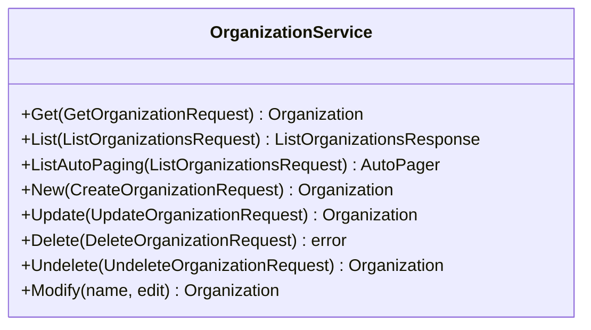

<!-- Code generated by protoc-gen-sdk 0.1.1. DO NOT EDIT. -->
# client.Organizations

Organizations manages the RFC 4519 'organization' object class,
section 3.8 <https://www.rfc-editor.org/rfc/rfc4519.html#section-3.8>.

`client.Organizations` is a `OrganizationService` over `protobuf.rfc4519.organization.v1.Organizations`.




## Get

```go
func (s *OrganizationService) Get(ctx context.Context, params *organizationpb.GetOrganizationRequest, opts ...option.RequestOption) (*organizationpb.Organization, error)
```

Calls `protobuf.rfc4519.organization.v1.Organizations.GetOrganization` (`GET /v1/{name=organizations/*}`).

Retrieves one organization.

  GET /v1/{name=organizations/*}

Safe and idempotent. Returns the resource as stored; no field is computed
per-caller. Read the `etag` here and pass it back on update or delete to
make the write conditional.

  NOT_FOUND          no such organization, or it is soft-deleted and `show_deleted` was not set
  INVALID_ARGUMENT   name does not match organizations/*
  PERMISSION_DENIED  caller may not read it

| Field | Type | Required | |
|---|---|---|---|
| `Name` | `string` | yes | // Name of the organization to retrieve, "organizations/{organization}". |

```go
organization, err := client.Organizations.Get(ctx, &organizationpb.GetOrganizationRequest{
	Name: "organizations/my-organization",
})
if err != nil {
	return err
}
fmt.Println(organization.String())
```

## List

```go
func (s *OrganizationService) List(ctx context.Context, params *organizationpb.ListOrganizationsRequest, opts ...option.RequestOption) (*organizationpb.ListOrganizationsResponse, error)
```

Returns one page. `ListAutoPaging` takes the same params and returns an
`*AutoPager` over every item.

Calls `protobuf.rfc4519.organization.v1.Organizations.ListOrganizations` (`GET /v1/organizations`).

Lists organizations.

  GET /v1/organizations

Paginated per AIP-158: pass `page_size` (defaults to 50, capped at 1000)
and the `next_page_token` from the previous response. An empty
`next_page_token` means the last page. Page tokens are opaque and may
expire; do not construct or store them.

Filtering uses the AIP-160 expression language over the resource's own
fields. Results carry no guaranteed order.

  INVALID_ARGUMENT   malformed filter, or page_size out of range
  PERMISSION_DENIED  caller may not list this collection

| Field | Type | Required | |
|---|---|---|---|
| `PageSize` | `int32` |  | // Maximum organizations to return. |
| `PageToken` | `string` |  | // Page token from a previous ListOrganizationsResponse.next_page_token. |
| `Filter` | `string` |  | // Filter expression, AIP-160 <https://aip.dev/160>. |
| `ShowDeleted` | `bool` |  | // Include soft-deleted organizations in the result. |

```go
for organization, err := range client.Organizations.ListAutoPaging(ctx, &organizationpb.ListOrganizationsRequest{}).All() {
	if err != nil {
		return err
	}
	fmt.Println(organization.String())
}
```

## New

```go
func (s *OrganizationService) New(ctx context.Context, params *organizationpb.CreateOrganizationRequest, opts ...option.RequestOption) (*organizationpb.Organization, error)
```

Calls `protobuf.rfc4519.organization.v1.Organizations.CreateOrganization` (`POST /v1/organizations`).

Creates an organization.

  POST /v1/organizations
  body: the organization itself

Server-assigned fields on the request body are ignored: `name`, `uid`,
`etag` and the timestamps are set by the server regardless of what is
sent. Supply `organization_id` to choose the final path segment; leave it empty
and the server generates one.

Not idempotent. Retrying after a timeout may create a second organization;
supply `organization_id` if the caller needs retry safety.

  ALREADY_EXISTS     that organization_id is taken
  INVALID_ARGUMENT   a field violates its buf.validate constraint
  PERMISSION_DENIED  caller may not create here

| Field | Type | Required | |
|---|---|---|---|
| `Organization` | `*organizationpb.Organization` | yes | // The organization to create. |
| `OrganizationId` | `string` |  | // Client-assigned id, becoming the last segment of the resource name. |

```go
organization, err := client.Organizations.New(ctx, &organizationpb.CreateOrganizationRequest{
	Organization: &organizationpb.Organization{
		DisplayNames: []string{"display-names"},
	},
})
if err != nil {
	return err
}
fmt.Println(organization.String())
```

## Update

```go
func (s *OrganizationService) Update(ctx context.Context, params *organizationpb.UpdateOrganizationRequest, opts ...option.RequestOption) (*organizationpb.Organization, error)
```

Calls `protobuf.rfc4519.organization.v1.Organizations.UpdateOrganization` (`PATCH /v1/{organization.name=organizations/*}`).

Updates an organization.

  PATCH /v1/{organization.name=organizations/*}
  body: the organization itself

A partial update: only fields named in `update_mask` are written. An
empty mask writes every mutable field, which will clear anything the
caller left unset -- pass a mask unless that is the intent. OUTPUT_ONLY
and IMMUTABLE fields are rejected rather than silently dropped.

Idempotent. Pass the `etag` read from Get to make the write conditional.

  NOT_FOUND          no such organization
  ABORTED            etag does not match the stored resource
  INVALID_ARGUMENT   mask names an unknown or immutable field
  PERMISSION_DENIED  caller may not modify it

| Field | Type | Required | |
|---|---|---|---|
| `Organization` | `*organizationpb.Organization` | yes | // The organization to update. |
| `UpdateMask` | `*fieldmaskpb.FieldMask` |  | // Fields to update. |

```go
organization, err := client.Organizations.Update(ctx, &organizationpb.UpdateOrganizationRequest{
	Organization: &organizationpb.Organization{
		DisplayNames: []string{"display-names"},
	},
})
if err != nil {
	return err
}
fmt.Println(organization.String())
```

## Delete

```go
func (s *OrganizationService) Delete(ctx context.Context, params *organizationpb.DeleteOrganizationRequest, opts ...option.RequestOption) error
```

Calls `protobuf.rfc4519.organization.v1.Organizations.DeleteOrganization` (`DELETE /v1/{name=organizations/*}`).

Deletes an organization.

  DELETE /v1/{name=organizations/*}

Soft delete: the organization is marked deleted, disappears from List unless
`show_deleted` is set, and is purged at `expire_time`. Recover it with
Undelete before then.

Idempotent in effect but not in reporting: a second delete returns
NOT_FOUND rather than succeeding silently.

  NOT_FOUND          no such organization
  ABORTED            etag does not match
  PERMISSION_DENIED  caller may not delete it

| Field | Type | Required | |
|---|---|---|---|
| `Name` | `string` | yes | // Name of the organization to delete, "organizations/{organization}". |

```go
if err := client.Organizations.Delete(ctx, &organizationpb.DeleteOrganizationRequest{
	Name: "organizations/my-organization",
}); err != nil {
	return err
}
```

## Undelete

```go
func (s *OrganizationService) Undelete(ctx context.Context, params *organizationpb.UndeleteOrganizationRequest, opts ...option.RequestOption) (*organizationpb.Organization, error)
```

Calls `protobuf.rfc4519.organization.v1.Organizations.UndeleteOrganization` (`POST /v1/{name=organizations/*}:undelete`).

Restores a soft-deleted organization.

  POST /v1/{name=organizations/*}:undelete

Valid only before `expire_time`; after that the organization is gone and this
returns NOT_FOUND. Clears `delete_time` and `expire_time` and returns the
organization as it was.

  NOT_FOUND          no such organization, or already purged
  ALREADY_EXISTS     the organization is not deleted
  PERMISSION_DENIED  caller may not restore it

| Field | Type | Required | |
|---|---|---|---|
| `Name` | `string` | yes | // Name of the soft-deleted organization to restore. |

```go
organization, err := client.Organizations.Undelete(ctx, &organizationpb.UndeleteOrganizationRequest{
	Name: "organizations/my-organization",
})
if err != nil {
	return err
}
fmt.Println(organization.String())
```
