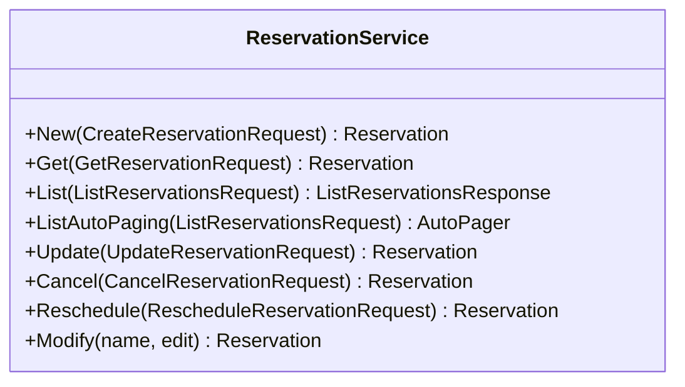

<!-- Code generated by protoc-gen-sdk dev. DO NOT EDIT. -->
# client.Reservations

ReservationService turns holds into confirmed bookings, updates and cancels
them.

It is where HoldService's conversion is driven from: a hold is never
converted by a caller reaching into HoldService, only by a reservation being
made of it. UpdateReservation changes only what the engine does not own --
the customer and the attributes. The window and resources are the hold's,
and changing either is a new hold and a new reservation, which is exactly
what RescheduleReservation does.

`client.Reservations` is a `ReservationService` over `freebusy.reservation.v1.ReservationService`.




## New

```go
func (s *ReservationService) New(ctx context.Context, params *reservationpb.CreateReservationRequest, opts ...option.RequestOption) (*reservationpb.Reservation, error)
```

Calls `freebusy.reservation.v1.ReservationService.CreateReservation` (`POST /v1/{parent=organizationalUnits/*}/reservations`).

Makes a reservation from a live hold, converting the hold so its
resources stay taken.

Idempotent: a hold backs at most one reservation, so a retry returns the
reservation the first call made. Fails with FAILED_PRECONDITION when the
hold has lapsed or been released.

| Field | Type | Required | |
|---|---|---|---|
| `Parent` | `string` | yes | // The site the hold was taken at. |
| `Reservation` | `*reservationpb.Reservation` | yes | // The reservation to make. |
| `ReservationId` | `string` |  | // Client-assigned id, becoming the last segment of the reservation name. |

```go
reservation, err := client.Reservations.New(ctx, &reservationpb.CreateReservationRequest{
	Parent: "organizationalUnits/{organizational_unit}",
	Reservation: &reservationpb.Reservation{ /* … */ },
})
if err != nil {
	return err
}
```

## Get

```go
func (s *ReservationService) Get(ctx context.Context, params *reservationpb.GetReservationRequest, opts ...option.RequestOption) (*reservationpb.Reservation, error)
```

Calls `freebusy.reservation.v1.ReservationService.GetReservation` (`GET /v1/{name=organizationalUnits/*/reservations/*}`).

Retrieves one reservation.

| Field | Type | Required | |
|---|---|---|---|
| `Name` | `string` | yes | // Format: organizationalUnits/{organizational_unit}/reservations/{reservation} |

```go
reservation, err := client.Reservations.Get(ctx, &reservationpb.GetReservationRequest{
	Name: "organizationalUnits/{organizational_unit}/reservations/{reservation}",
})
if err != nil {
	return err
}
```

## List

```go
func (s *ReservationService) List(ctx context.Context, params *reservationpb.ListReservationsRequest, opts ...option.RequestOption) (*reservationpb.ListReservationsResponse, error)
```

Returns one page. `ListAutoPaging` takes the same params and returns an
`*AutoPager` over every item.

Calls `freebusy.reservation.v1.ReservationService.ListReservations` (`GET /v1/{parent=organizationalUnits/*}/reservations`).

Lists a site's reservations.

| Field | Type | Required | |
|---|---|---|---|
| `Parent` | `string` | yes | // Format: organizationalUnits/{organizational_unit} |
| `PageSize` | `int32` |  | // Maximum reservations to return. |
| `PageToken` | `string` |  | // Page token from a previous ListReservationsResponse.next_page_token. |
| `Filter` | `string` |  | // Filter expression, AIP-160, e.g. |
| `OrderBy` | `string` |  | // Ordering, AIP-132, e.g. |

```go
pager := client.Reservations.ListAutoPaging(ctx, &reservationpb.ListReservationsRequest{
	Parent: "organizationalUnits/{organizational_unit}",
})
for pager.Next() {
	item := pager.Current()
	_ = item
}
if err := pager.Err(); err != nil {
	return err
}
```

## Update

```go
func (s *ReservationService) Update(ctx context.Context, params *reservationpb.UpdateReservationRequest, opts ...option.RequestOption) (*reservationpb.Reservation, error)
```

Calls `freebusy.reservation.v1.ReservationService.UpdateReservation` (`PATCH /v1/{reservation.name=organizationalUnits/*/reservations/*}`).

Updates a confirmed reservation's customer or attributes, AIP-134.

update_mask is required and may name only `customer` and `attributes`;
everything else is the engine's, and is changed by CancelReservation or
RescheduleReservation. `reservation.etag`, when set, must match the
stored one (AIP-154). Fails with FAILED_PRECONDITION unless the
reservation is confirmed.

| Field | Type | Required | |
|---|---|---|---|
| `Reservation` | `*reservationpb.Reservation` | yes | // The reservation, its name identifying which. |
| `UpdateMask` | `*fieldmaskpb.FieldMask` |  | // The fields to change: `customer`, `attributes`, or both; `*` is both. |

```go
reservation, err := client.Reservations.Update(ctx, &reservationpb.UpdateReservationRequest{
	Reservation: &reservationpb.Reservation{ /* … */ },
})
if err != nil {
	return err
}
```

## Cancel

```go
func (s *ReservationService) Cancel(ctx context.Context, params *reservationpb.CancelReservationRequest, opts ...option.RequestOption) (*reservationpb.Reservation, error)
```

Calls `freebusy.reservation.v1.ReservationService.CancelReservation` (`POST /v1/{name=organizationalUnits/*/reservations/*}:cancel`).

Cancels a reservation, freeing its resources.

Idempotent: cancelling a cancelled reservation succeeds and changes
nothing.

| Field | Type | Required | |
|---|---|---|---|
| `Name` | `string` | yes | // Format: organizationalUnits/{organizational_unit}/reservations/{reservation} |
| `Reason` | `string` |  | // Why, in the canceller's words. |
| `Etag` | `string` |  | // Opaque version read from the reservation; the cancel is rejected if it // changed since (AIP-154). |

```go
reservation, err := client.Reservations.Cancel(ctx, &reservationpb.CancelReservationRequest{
	Name: "organizationalUnits/{organizational_unit}/reservations/{reservation}",
})
if err != nil {
	return err
}
```

## Reschedule

```go
func (s *ReservationService) Reschedule(ctx context.Context, params *reservationpb.RescheduleReservationRequest, opts ...option.RequestOption) (*reservationpb.Reservation, error)
```

Calls `freebusy.reservation.v1.ReservationService.RescheduleReservation` (`POST /v1/{name=organizationalUnits/*/reservations/*}:reschedule`).

Moves a confirmed reservation onto a new hold, returning the reservation
that replaces it.

The replacement is a new reservation made from the new hold, linked both
ways (`replaces`, `replacement`); the original ends RESCHEDULED. The
original keeps its resources until the replacement is confirmed, so a
failure part-way -- the new hold lapsing, a crash -- leaves the customer
with their old booking, never with neither. A new hold taken with
`replaces` naming the original's hold may overlap the original's window on
the same resources -- an extension in place -- and the overlap passes to
the replacement in the same write that frees the original. Idempotent:
repeating the call with the same hold returns the same replacement.

| Field | Type | Required | |
|---|---|---|---|
| `Name` | `string` | yes | // The confirmed reservation to move. |
| `Hold` | `string` | yes | // A live hold at the same site on the new window, taken by the caller with // HoldService.CreateHold. |
| `Etag` | `string` |  | // Opaque version read from the reservation; the move is rejected if it // changed since (AIP-154). |

```go
reservation, err := client.Reservations.Reschedule(ctx, &reservationpb.RescheduleReservationRequest{
	Name: "organizationalUnits/{organizational_unit}/reservations/{reservation}",
	Hold: "…",
})
if err != nil {
	return err
}
```
