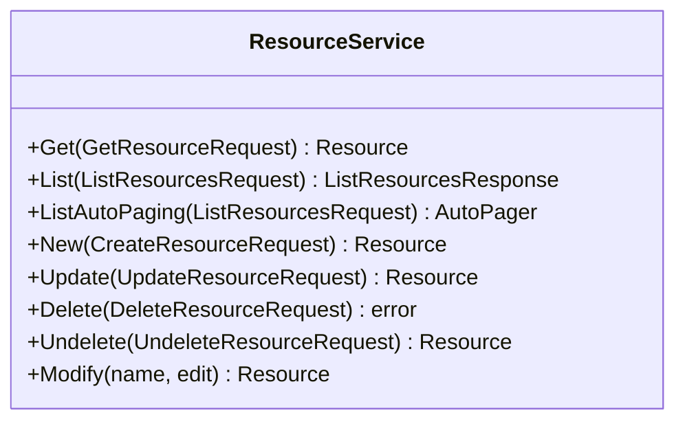

<!-- Code generated by protoc-gen-sdk 0.1.1. DO NOT EDIT. -->
# client.Resources

Resources manages the RFC 9073 VRESOURCE component as a catalogue,
section 7.3 <https://www.rfc-editor.org/rfc/rfc9073.html#section-7.3>.

`client.Resources` is a `ResourceService` over `protobuf.rfc9073.resource.v1.Resources`.




## Get

```go
func (s *ResourceService) Get(ctx context.Context, params *resourcepb.GetResourceRequest, opts ...option.RequestOption) (*resourcepb.Resource, error)
```

Calls `protobuf.rfc9073.resource.v1.Resources.GetResource` (`GET /v1/{name=resources/*}`).

Retrieves one resource.

  GET /v1/{name=resources/*}

Safe and idempotent. Returns the resource as stored; no field is computed
per-caller. Read the `etag` here and pass it back on update or delete to
make the write conditional.

  NOT_FOUND          no such resource, or it is soft-deleted and `show_deleted` was not set
  INVALID_ARGUMENT   name does not match resources/*
  PERMISSION_DENIED  caller may not read it

| Field | Type | Required | |
|---|---|---|---|
| `Name` | `string` | yes | // Name of the resource to retrieve, "resources/{resource}". |

```go
resource, err := client.Resources.Get(ctx, &resourcepb.GetResourceRequest{
	Name: "resources/my-resource",
})
if err != nil {
	return err
}
fmt.Println(resource.String())
```

## List

```go
func (s *ResourceService) List(ctx context.Context, params *resourcepb.ListResourcesRequest, opts ...option.RequestOption) (*resourcepb.ListResourcesResponse, error)
```

Returns one page. `ListAutoPaging` takes the same params and returns an
`*AutoPager` over every item.

Calls `protobuf.rfc9073.resource.v1.Resources.ListResources` (`GET /v1/resources`).

Lists resources.

  GET /v1/resources

Paginated per AIP-158: pass `page_size` (defaults to 50, capped at 1000)
and the `next_page_token` from the previous response. An empty
`next_page_token` means the last page. Page tokens are opaque and may
expire; do not construct or store them.

Filtering uses the AIP-160 expression language over the resource's own
fields -- `organizational_unit="organizationalUnits/car-park-3"` lists
what one site holds, and `resource_types:"room"` narrows by kind, since
the collection is flat rather than nested. Results carry no guaranteed
order.

  INVALID_ARGUMENT   malformed filter, or page_size out of range
  PERMISSION_DENIED  caller may not list this collection

| Field | Type | Required | |
|---|---|---|---|
| `PageSize` | `int32` |  | // Maximum resources to return. |
| `PageToken` | `string` |  | // Page token from a previous ListResourcesResponse.next_page_token. |
| `Filter` | `string` |  | // Filter expression, AIP-160 <https://aip.dev/160>. |
| `ShowDeleted` | `bool` |  | // Include soft-deleted resources in the result. |

```go
for resource, err := range client.Resources.ListAutoPaging(ctx, &resourcepb.ListResourcesRequest{}).All() {
	if err != nil {
		return err
	}
	fmt.Println(resource.String())
}
```

## New

```go
func (s *ResourceService) New(ctx context.Context, params *resourcepb.CreateResourceRequest, opts ...option.RequestOption) (*resourcepb.Resource, error)
```

Calls `protobuf.rfc9073.resource.v1.Resources.CreateResource` (`POST /v1/resources`).

Creates a resource.

  POST /v1/resources
  body: the resource itself

Server-assigned fields on the request body are ignored: `name`, `uid`,
`etag` and the timestamps are set by the server regardless of what is
sent. Supply `resource_id` to choose the final path segment; leave it
empty and the server generates one.

Not idempotent. Retrying after a timeout may create a second resource;
supply `resource_id` if the caller needs retry safety.

  ALREADY_EXISTS     that resource_id is taken
  INVALID_ARGUMENT   a field violates its buf.validate constraint
  PERMISSION_DENIED  caller may not create here

| Field | Type | Required | |
|---|---|---|---|
| `Resource` | `*resourcepb.Resource` | yes | // The resource to create. |
| `ResourceId` | `string` |  | // Client-assigned id, becoming the last segment of the resource name. |

```go
resource, err := client.Resources.New(ctx, &resourcepb.CreateResourceRequest{
	Resource: &resourcepb.Resource{},
})
if err != nil {
	return err
}
fmt.Println(resource.String())
```

## Update

```go
func (s *ResourceService) Update(ctx context.Context, params *resourcepb.UpdateResourceRequest, opts ...option.RequestOption) (*resourcepb.Resource, error)
```

Calls `protobuf.rfc9073.resource.v1.Resources.UpdateResource` (`PATCH /v1/{resource.name=resources/*}`).

Updates a resource.

  PATCH /v1/{resource.name=resources/*}
  body: the resource itself

A partial update: only fields named in `update_mask` are written. An
empty mask writes every mutable field, which will clear anything the
caller left unset -- pass a mask unless that is the intent. OUTPUT_ONLY
and IMMUTABLE fields are rejected rather than silently dropped.

Idempotent. Pass the `etag` read from Get to make the write conditional.

  NOT_FOUND          no such resource
  ABORTED            etag does not match the stored resource
  INVALID_ARGUMENT   mask names an unknown or immutable field
  PERMISSION_DENIED  caller may not modify it

| Field | Type | Required | |
|---|---|---|---|
| `Resource` | `*resourcepb.Resource` | yes | // The resource to update. |
| `UpdateMask` | `*fieldmaskpb.FieldMask` |  | // Fields to update. |

```go
resource, err := client.Resources.Update(ctx, &resourcepb.UpdateResourceRequest{
	Resource: &resourcepb.Resource{},
})
if err != nil {
	return err
}
fmt.Println(resource.String())
```

## Delete

```go
func (s *ResourceService) Delete(ctx context.Context, params *resourcepb.DeleteResourceRequest, opts ...option.RequestOption) error
```

Calls `protobuf.rfc9073.resource.v1.Resources.DeleteResource` (`DELETE /v1/{name=resources/*}`).

Deletes a resource.

  DELETE /v1/{name=resources/*}

Soft delete: the resource is marked deleted, disappears from List unless
`show_deleted` is set, and is purged at `expire_time`. Recover it with
Undelete before then. Bookings already on its calendar are untouched --
retiring a bay does not cancel what is parked on it.

Idempotent in effect but not in reporting: a second delete returns
NOT_FOUND rather than succeeding silently.

  NOT_FOUND          no such resource
  ABORTED            etag does not match
  PERMISSION_DENIED  caller may not delete it

| Field | Type | Required | |
|---|---|---|---|
| `Name` | `string` | yes | // Name of the resource to delete, "resources/{resource}". |

```go
if err := client.Resources.Delete(ctx, &resourcepb.DeleteResourceRequest{
	Name: "resources/my-resource",
}); err != nil {
	return err
}
```

## Undelete

```go
func (s *ResourceService) Undelete(ctx context.Context, params *resourcepb.UndeleteResourceRequest, opts ...option.RequestOption) (*resourcepb.Resource, error)
```

Calls `protobuf.rfc9073.resource.v1.Resources.UndeleteResource` (`POST /v1/{name=resources/*}:undelete`).

Restores a soft-deleted resource.

  POST /v1/{name=resources/*}:undelete

Valid only before `expire_time`; after that the resource is gone and this
returns NOT_FOUND. Clears `delete_time` and `expire_time` and returns the
resource as it was.

  NOT_FOUND          no such resource, or already purged
  ALREADY_EXISTS     the resource is not deleted
  PERMISSION_DENIED  caller may not restore it

| Field | Type | Required | |
|---|---|---|---|
| `Name` | `string` | yes | // Name of the soft-deleted resource to restore. |

```go
resource, err := client.Resources.Undelete(ctx, &resourcepb.UndeleteResourceRequest{
	Name: "resources/my-resource",
})
if err != nil {
	return err
}
fmt.Println(resource.String())
```
