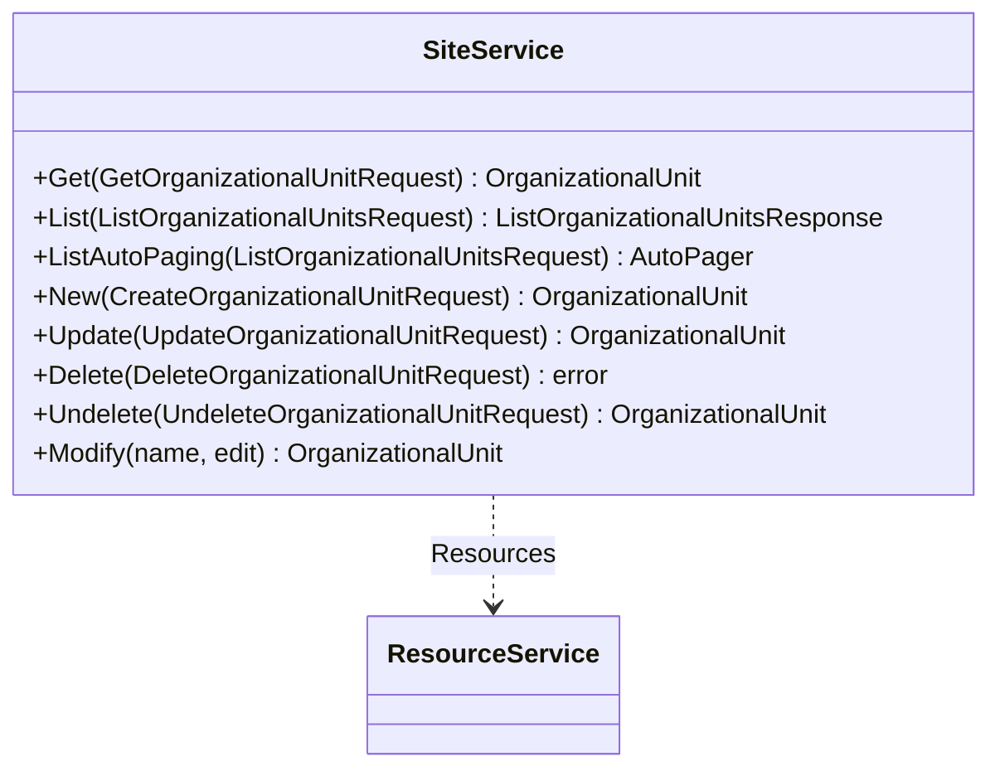

<!-- Code generated by protoc-gen-sdk dev. DO NOT EDIT. -->
# client.Sites

OrganizationalUnits manages the RFC 4519 'organizationalUnit' object
class, section 3.11 <https://www.rfc-editor.org/rfc/rfc4519.html#section-3.11>.

`client.Sites` is a `SiteService` over `protobuf.rfc4519.organizational_unit.v1.OrganizationalUnits`.




## Get

```go
func (s *SiteService) Get(ctx context.Context, params *organizationalunitpb.GetOrganizationalUnitRequest, opts ...option.RequestOption) (*organizationalunitpb.OrganizationalUnit, error)
```

Calls `protobuf.rfc4519.organizational_unit.v1.OrganizationalUnits.GetOrganizationalUnit` (`GET /v1/{name=organizationalUnits/*}`).

Retrieves one organizational unit.

  GET /v1/{name=organizationalUnits/*}

Safe and idempotent. Returns the resource as stored; no field is computed
per-caller. Read the `etag` here and pass it back on update or delete to
make the write conditional.

  NOT_FOUND          no such organizational unit, or it is soft-deleted and `show_deleted` was not set
  INVALID_ARGUMENT   name does not match organizationalUnits/*
  PERMISSION_DENIED  caller may not read it

| Field | Type | Required | |
|---|---|---|---|
| `Name` | `string` | yes | // Name of the organizational unit to retrieve, "organizationalUnits/{organizationalUnit}". |

```go
organizationalUnit, err := client.Sites.Get(ctx, &organizationalunitpb.GetOrganizationalUnitRequest{
	Name: "organizationalUnits/my-organizational-unit",
})
if err != nil {
	return err
}
fmt.Println(organizationalUnit.String())
```

## List

```go
func (s *SiteService) List(ctx context.Context, params *organizationalunitpb.ListOrganizationalUnitsRequest, opts ...option.RequestOption) (*organizationalunitpb.ListOrganizationalUnitsResponse, error)
```

Returns one page. `ListAutoPaging` takes the same params and returns an
`*AutoPager` over every item.

Calls `protobuf.rfc4519.organizational_unit.v1.OrganizationalUnits.ListOrganizationalUnits` (`GET /v1/organizationalUnits`).

Lists organizational units.

  GET /v1/organizationalUnits

Paginated per AIP-158: pass `page_size` (defaults to 50, capped at 1000)
and the `next_page_token` from the previous response. An empty
`next_page_token` means the last page. Page tokens are opaque and may
expire; do not construct or store them.

Filtering uses the AIP-160 expression language over the resource's own
fields -- `organization="organizations/example"` finds every unit under
one organization, since the collection is flat rather than nested.
Results carry no guaranteed order.

  INVALID_ARGUMENT   malformed filter, or page_size out of range
  PERMISSION_DENIED  caller may not list this collection

| Field | Type | Required | |
|---|---|---|---|
| `PageSize` | `int32` |  | // Maximum organizational units to return. |
| `PageToken` | `string` |  | // Page token from a previous ListOrganizationalUnitsResponse.next_page_token. |
| `Filter` | `string` |  | // Filter expression, AIP-160 <https://aip.dev/160>. |
| `ShowDeleted` | `bool` |  | // Include soft-deleted organizational units in the result. |

```go
for organizationalUnit, err := range client.Sites.ListAutoPaging(ctx, &organizationalunitpb.ListOrganizationalUnitsRequest{}).All() {
	if err != nil {
		return err
	}
	fmt.Println(organizationalUnit.String())
}
```

## New

```go
func (s *SiteService) New(ctx context.Context, params *organizationalunitpb.CreateOrganizationalUnitRequest, opts ...option.RequestOption) (*organizationalunitpb.OrganizationalUnit, error)
```

Calls `protobuf.rfc4519.organizational_unit.v1.OrganizationalUnits.CreateOrganizationalUnit` (`POST /v1/organizationalUnits`).

Creates an organizational unit.

  POST /v1/organizationalUnits
  body: the organizational unit itself

Server-assigned fields on the request body are ignored: `name`, `uid`,
`etag` and the timestamps are set by the server regardless of what is
sent. Supply `organizational_unit_id` to choose the final path segment;
leave it empty and the server generates one.

Not idempotent. Retrying after a timeout may create a second organizational
unit; supply `organizational_unit_id` if the caller needs retry safety.

  ALREADY_EXISTS     that organizational_unit_id is taken
  INVALID_ARGUMENT   a field violates its buf.validate constraint
  PERMISSION_DENIED  caller may not create here

| Field | Type | Required | |
|---|---|---|---|
| `OrganizationalUnit` | `*organizationalunitpb.OrganizationalUnit` | yes | // The organizational unit to create. |
| `OrganizationalUnitId` | `string` |  | // Client-assigned id, becoming the last segment of the resource name. |

```go
organizationalUnit, err := client.Sites.New(ctx, &organizationalunitpb.CreateOrganizationalUnitRequest{
	OrganizationalUnit: &organizationalunitpb.OrganizationalUnit{
		DisplayNames: []string{"display-names"},
	},
})
if err != nil {
	return err
}
fmt.Println(organizationalUnit.String())
```

## Update

```go
func (s *SiteService) Update(ctx context.Context, params *organizationalunitpb.UpdateOrganizationalUnitRequest, opts ...option.RequestOption) (*organizationalunitpb.OrganizationalUnit, error)
```

Calls `protobuf.rfc4519.organizational_unit.v1.OrganizationalUnits.UpdateOrganizationalUnit` (`PATCH /v1/{organizational_unit.name=organizationalUnits/*}`).

Updates an organizational unit.

  PATCH /v1/{organizational_unit.name=organizationalUnits/*}
  body: the organizational unit itself

A partial update: only fields named in `update_mask` are written. An
empty mask writes every mutable field, which will clear anything the
caller left unset -- pass a mask unless that is the intent. OUTPUT_ONLY
and IMMUTABLE fields are rejected rather than silently dropped.

Idempotent. Pass the `etag` read from Get to make the write conditional.

  NOT_FOUND          no such organizational unit
  ABORTED            etag does not match the stored resource
  INVALID_ARGUMENT   mask names an unknown or immutable field
  PERMISSION_DENIED  caller may not modify it

| Field | Type | Required | |
|---|---|---|---|
| `OrganizationalUnit` | `*organizationalunitpb.OrganizationalUnit` | yes | // The organizational unit to update. |
| `UpdateMask` | `*fieldmaskpb.FieldMask` |  | // Fields to update. |

```go
organizationalUnit, err := client.Sites.Update(ctx, &organizationalunitpb.UpdateOrganizationalUnitRequest{
	OrganizationalUnit: &organizationalunitpb.OrganizationalUnit{
		DisplayNames: []string{"display-names"},
	},
})
if err != nil {
	return err
}
fmt.Println(organizationalUnit.String())
```

## Delete

```go
func (s *SiteService) Delete(ctx context.Context, params *organizationalunitpb.DeleteOrganizationalUnitRequest, opts ...option.RequestOption) error
```

Calls `protobuf.rfc4519.organizational_unit.v1.OrganizationalUnits.DeleteOrganizationalUnit` (`DELETE /v1/{name=organizationalUnits/*}`).

Deletes an organizational unit.

  DELETE /v1/{name=organizationalUnits/*}

Soft delete: the organizational unit is marked deleted, disappears from
List unless `show_deleted` is set, and is purged at `expire_time`.
Recover it with Undelete before then.

Idempotent in effect but not in reporting: a second delete returns
NOT_FOUND rather than succeeding silently.

  NOT_FOUND          no such organizational unit
  ABORTED            etag does not match
  PERMISSION_DENIED  caller may not delete it

| Field | Type | Required | |
|---|---|---|---|
| `Name` | `string` | yes | // Name of the organizational unit to delete, "organizationalUnits/{organizationalUnit}". |

```go
if err := client.Sites.Delete(ctx, &organizationalunitpb.DeleteOrganizationalUnitRequest{
	Name: "organizationalUnits/my-organizational-unit",
}); err != nil {
	return err
}
```

## Undelete

```go
func (s *SiteService) Undelete(ctx context.Context, params *organizationalunitpb.UndeleteOrganizationalUnitRequest, opts ...option.RequestOption) (*organizationalunitpb.OrganizationalUnit, error)
```

Calls `protobuf.rfc4519.organizational_unit.v1.OrganizationalUnits.UndeleteOrganizationalUnit` (`POST /v1/{name=organizationalUnits/*}:undelete`).

Restores a soft-deleted organizational unit.

  POST /v1/{name=organizationalUnits/*}:undelete

Valid only before `expire_time`; after that the organizational unit is
gone and this returns NOT_FOUND. Clears `delete_time` and `expire_time`
and returns the organizational unit as it was.

  NOT_FOUND          no such organizational unit, or already purged
  ALREADY_EXISTS     the organizational unit is not deleted
  PERMISSION_DENIED  caller may not restore it

| Field | Type | Required | |
|---|---|---|---|
| `Name` | `string` | yes | // Name of the soft-deleted organizational unit to restore. |

```go
organizationalUnit, err := client.Sites.Undelete(ctx, &organizationalunitpb.UndeleteOrganizationalUnitRequest{
	Name: "organizationalUnits/my-organizational-unit",
})
if err != nil {
	return err
}
fmt.Println(organizationalUnit.String())
```
