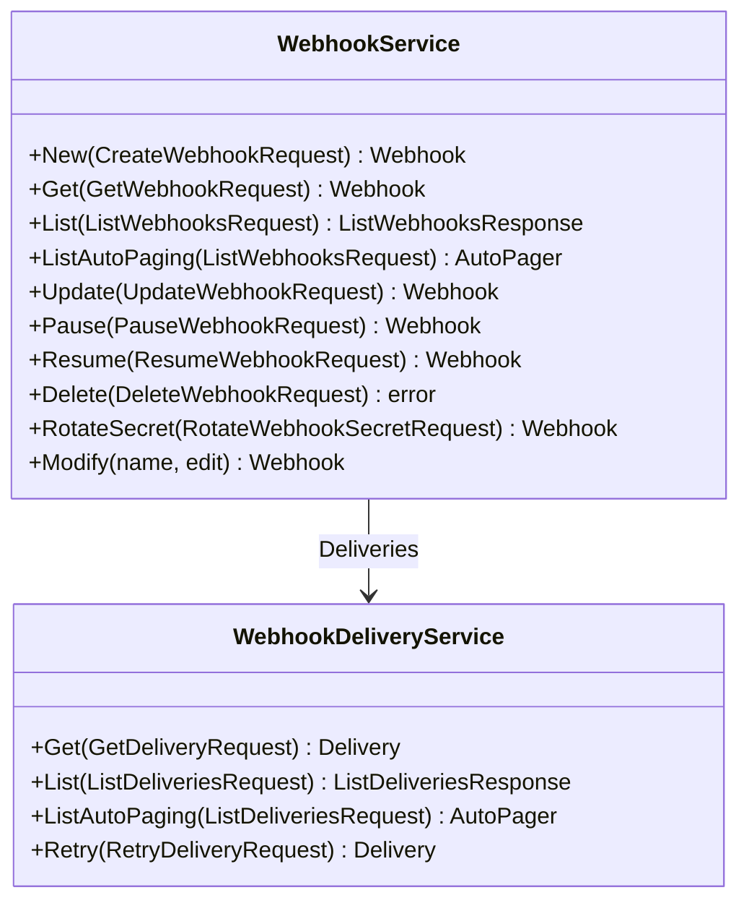

<!-- Code generated by protoc-gen-sdk dev. DO NOT EDIT. -->
# client.Webhooks

WebhookService subscribes endpoints to changes in holds, reservations and
inventory, and shows what was sent to each.

`client.Webhooks` is a `WebhookService` over `freebusy.webhook.v1.WebhookService`.




## New

```go
func (s *WebhookService) New(ctx context.Context, params *webhookpb.CreateWebhookRequest, opts ...option.RequestOption) (*webhookpb.Webhook, error)
```

Calls `freebusy.webhook.v1.WebhookService.CreateWebhook` (`POST /v1/webhooks`).

Creates a webhook. The response carries its signing secret, which no
later read returns.

| Field | Type | Required | |
|---|---|---|---|
| `Webhook` | `*webhookpb.Webhook` | yes | // The webhook to create. |
| `WebhookId` | `string` |  | // Client-assigned id, becoming the last segment of the webhook name. |

```go
webhook, err := client.Webhooks.New(ctx, &webhookpb.CreateWebhookRequest{
	Webhook: &webhookpb.Webhook{
		Uri: "uri",
	},
})
if err != nil {
	return err
}
fmt.Println(webhook.String())
```

## Get

```go
func (s *WebhookService) Get(ctx context.Context, params *webhookpb.GetWebhookRequest, opts ...option.RequestOption) (*webhookpb.Webhook, error)
```

Calls `freebusy.webhook.v1.WebhookService.GetWebhook` (`GET /v1/{name=webhooks/*}`).

Retrieves one webhook, without its secret.

| Field | Type | Required | |
|---|---|---|---|
| `Name` | `string` | yes | // Format: webhooks/{webhook} |

```go
webhook, err := client.Webhooks.Get(ctx, &webhookpb.GetWebhookRequest{
	Name: "webhooks/my-webhook",
})
if err != nil {
	return err
}
fmt.Println(webhook.String())
```

## List

```go
func (s *WebhookService) List(ctx context.Context, params *webhookpb.ListWebhooksRequest, opts ...option.RequestOption) (*webhookpb.ListWebhooksResponse, error)
```

Returns one page. `ListAutoPaging` takes the same params and returns an
`*AutoPager` over every item.

Calls `freebusy.webhook.v1.WebhookService.ListWebhooks` (`GET /v1/webhooks`).

Lists webhooks, without their secrets.

| Field | Type | Required | |
|---|---|---|---|
| `PageSize` | `int32` |  | // Maximum webhooks to return. |
| `PageToken` | `string` |  | // Page token from a previous ListWebhooksResponse.next_page_token. |

```go
for webhook, err := range client.Webhooks.ListAutoPaging(ctx, &webhookpb.ListWebhooksRequest{}).All() {
	if err != nil {
		return err
	}
	fmt.Println(webhook.String())
}
```

## Update

```go
func (s *WebhookService) Update(ctx context.Context, params *webhookpb.UpdateWebhookRequest, opts ...option.RequestOption) (*webhookpb.Webhook, error)
```

Calls `freebusy.webhook.v1.WebhookService.UpdateWebhook` (`PATCH /v1/{webhook.name=webhooks/*}`).

Updates a webhook: its endpoint, event types or site.

| Field | Type | Required | |
|---|---|---|---|
| `Webhook` | `*webhookpb.Webhook` | yes | // The webhook, its name identifying which. |
| `UpdateMask` | `*fieldmaskpb.FieldMask` |  | // Fields to update: display_name, uri, event_types, organizational_unit. |

```go
webhook, err := client.Webhooks.Update(ctx, &webhookpb.UpdateWebhookRequest{
	Webhook: &webhookpb.Webhook{
		Uri: "uri",
	},
})
if err != nil {
	return err
}
fmt.Println(webhook.String())
```

## Pause

```go
func (s *WebhookService) Pause(ctx context.Context, params *webhookpb.PauseWebhookRequest, opts ...option.RequestOption) (*webhookpb.Webhook, error)
```

Calls `freebusy.webhook.v1.WebhookService.PauseWebhook` (`POST /v1/{name=webhooks/*}:pause`).

Stops sending a webhook changes. Changes made while it is paused are not
sent; deliveries already pending wait. Idempotent.

| Field | Type | Required | |
|---|---|---|---|
| `Name` | `string` | yes | // Format: webhooks/{webhook} |

```go
webhook, err := client.Webhooks.Pause(ctx, &webhookpb.PauseWebhookRequest{
	Name: "webhooks/my-webhook",
})
if err != nil {
	return err
}
fmt.Println(webhook.String())
```

## Resume

```go
func (s *WebhookService) Resume(ctx context.Context, params *webhookpb.ResumeWebhookRequest, opts ...option.RequestOption) (*webhookpb.Webhook, error)
```

Calls `freebusy.webhook.v1.WebhookService.ResumeWebhook` (`POST /v1/{name=webhooks/*}:resume`).

Starts sending a paused webhook changes again, from now on. Idempotent.

| Field | Type | Required | |
|---|---|---|---|
| `Name` | `string` | yes | // Format: webhooks/{webhook} |

```go
webhook, err := client.Webhooks.Resume(ctx, &webhookpb.ResumeWebhookRequest{
	Name: "webhooks/my-webhook",
})
if err != nil {
	return err
}
fmt.Println(webhook.String())
```

## Delete

```go
func (s *WebhookService) Delete(ctx context.Context, params *webhookpb.DeleteWebhookRequest, opts ...option.RequestOption) error
```

Calls `freebusy.webhook.v1.WebhookService.DeleteWebhook` (`DELETE /v1/{name=webhooks/*}`).

Deletes a webhook; with force, its deliveries too.

| Field | Type | Required | |
|---|---|---|---|
| `Name` | `string` | yes | // Format: webhooks/{webhook} |
| `Etag` | `string` |  | // Opaque version read from the webhook; the delete is rejected if it // changed since (AIP-154). |
| `Force` | `bool` |  | // Deletes the webhook's deliveries with it. |

```go
if err := client.Webhooks.Delete(ctx, &webhookpb.DeleteWebhookRequest{
	Name: "webhooks/my-webhook",
}); err != nil {
	return err
}
```

## RotateSecret

```go
func (s *WebhookService) RotateSecret(ctx context.Context, params *webhookpb.RotateWebhookSecretRequest, opts ...option.RequestOption) (*webhookpb.Webhook, error)
```

Calls `freebusy.webhook.v1.WebhookService.RotateWebhookSecret` (`POST /v1/{name=webhooks/*}:rotateSecret`).

Replaces a webhook's signing secret, returning the new one. For a day the
old secret signs deliveries too -- Standard Webhooks carries several
signatures in one header -- so a receiver can switch without missing one.

| Field | Type | Required | |
|---|---|---|---|
| `Name` | `string` | yes | // Format: webhooks/{webhook} |

```go
webhook, err := client.Webhooks.RotateSecret(ctx, &webhookpb.RotateWebhookSecretRequest{
	Name: "webhooks/my-webhook",
})
if err != nil {
	return err
}
fmt.Println(webhook.String())
```

# client.Webhooks.Deliveries

`client.Webhooks.Deliveries` is a `WebhookDeliveryService`.


## Get

```go
func (s *WebhookDeliveryService) Get(ctx context.Context, params *webhookpb.GetDeliveryRequest, opts ...option.RequestOption) (*webhookpb.Delivery, error)
```

Calls `freebusy.webhook.v1.WebhookService.GetDelivery` (`GET /v1/{name=webhooks/*/deliveries/*}`).

Retrieves one delivery.

| Field | Type | Required | |
|---|---|---|---|
| `Name` | `string` | yes | // Format: webhooks/{webhook}/deliveries/{delivery} |

```go
delivery, err := client.Webhooks.Deliveries.Get(ctx, &webhookpb.GetDeliveryRequest{
	Name: "webhooks/my-webhook/deliveries/my-deliverie",
})
if err != nil {
	return err
}
fmt.Println(delivery.String())
```

## List

```go
func (s *WebhookDeliveryService) List(ctx context.Context, params *webhookpb.ListDeliveriesRequest, opts ...option.RequestOption) (*webhookpb.ListDeliveriesResponse, error)
```

Returns one page. `ListAutoPaging` takes the same params and returns an
`*AutoPager` over every item.

Calls `freebusy.webhook.v1.WebhookService.ListDeliveries` (`GET /v1/{parent=webhooks/*}/deliveries`).

Lists a webhook's deliveries.

| Field | Type | Required | |
|---|---|---|---|
| `Parent` | `string` | yes | // Format: webhooks/{webhook} |
| `PageSize` | `int32` |  | // Maximum deliveries to return. |
| `PageToken` | `string` |  | // Page token from a previous ListDeliveriesResponse.next_page_token. |
| `Filter` | `string` |  | // Filter expression, AIP-160, e.g. |
| `OrderBy` | `string` |  | // Ordering, AIP-132, e.g. |

```go
for delivery, err := range client.Webhooks.Deliveries.ListAutoPaging(ctx, &webhookpb.ListDeliveriesRequest{
	Parent: "webhooks/my-webhook",
}).All() {
	if err != nil {
		return err
	}
	fmt.Println(delivery.String())
}
```

## Retry

```go
func (s *WebhookDeliveryService) Retry(ctx context.Context, params *webhookpb.RetryDeliveryRequest, opts ...option.RequestOption) (*webhookpb.Delivery, error)
```

Calls `freebusy.webhook.v1.WebhookService.RetryDelivery` (`POST /v1/{name=webhooks/*/deliveries/*}:retry`).

Sends a delivery again, whatever its state: it goes back to PENDING with
its attempts reset and is attempted at once. The payload is the one
recorded, not the record as it stands now.

| Field | Type | Required | |
|---|---|---|---|
| `Name` | `string` | yes | // Format: webhooks/{webhook}/deliveries/{delivery} |

```go
delivery, err := client.Webhooks.Deliveries.Retry(ctx, &webhookpb.RetryDeliveryRequest{
	Name: "webhooks/my-webhook/deliveries/my-deliverie",
})
if err != nil {
	return err
}
fmt.Println(delivery.String())
```
